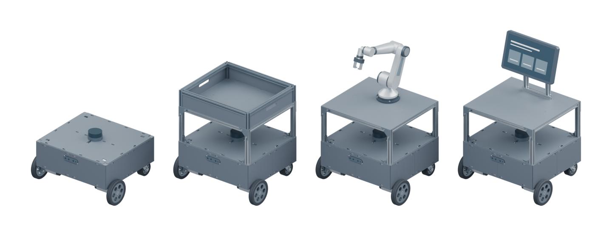
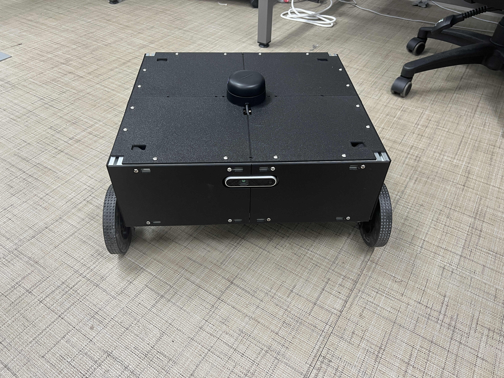
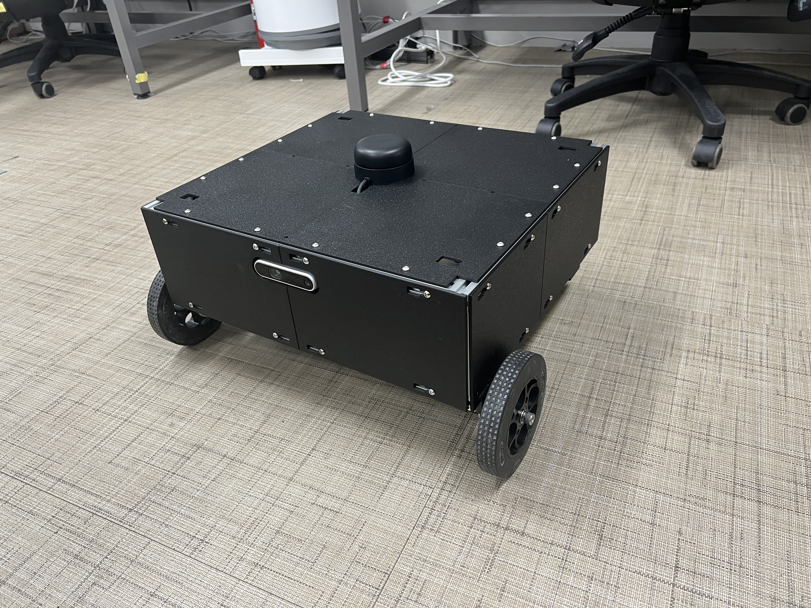
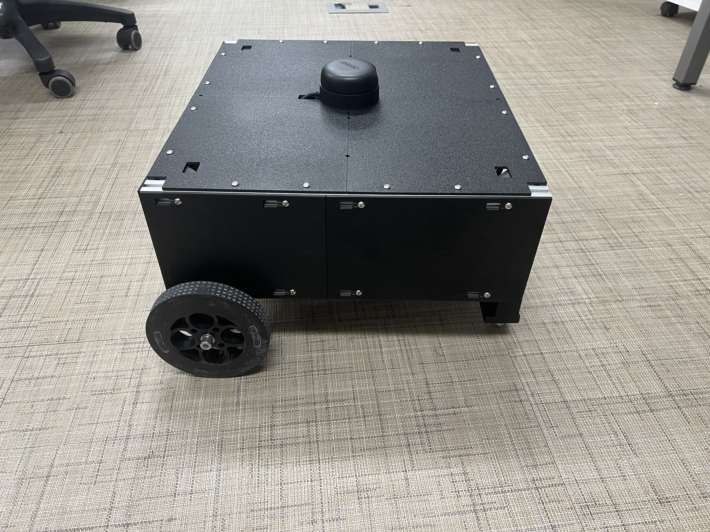
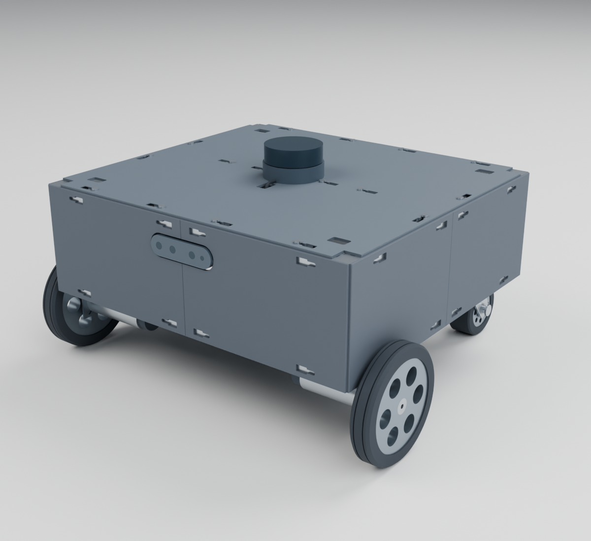
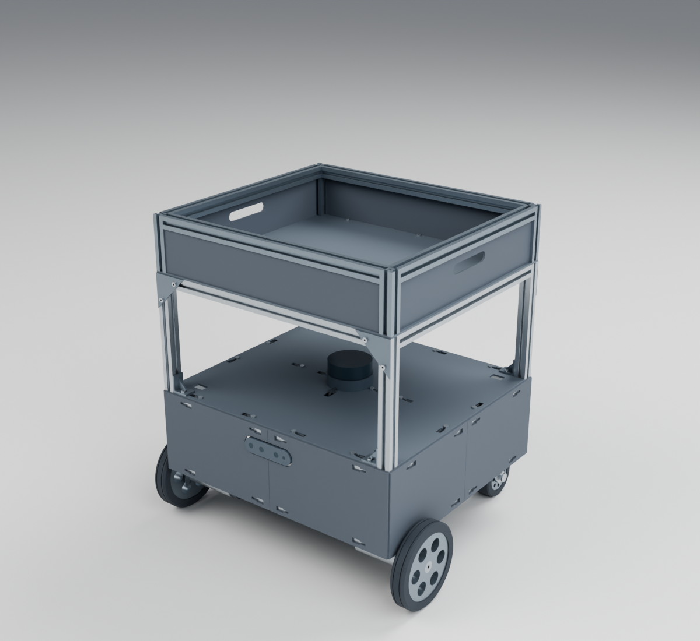
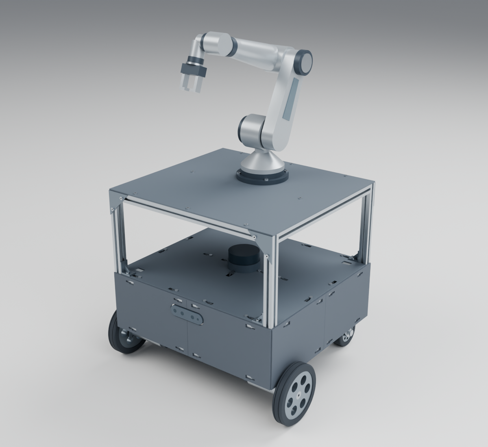
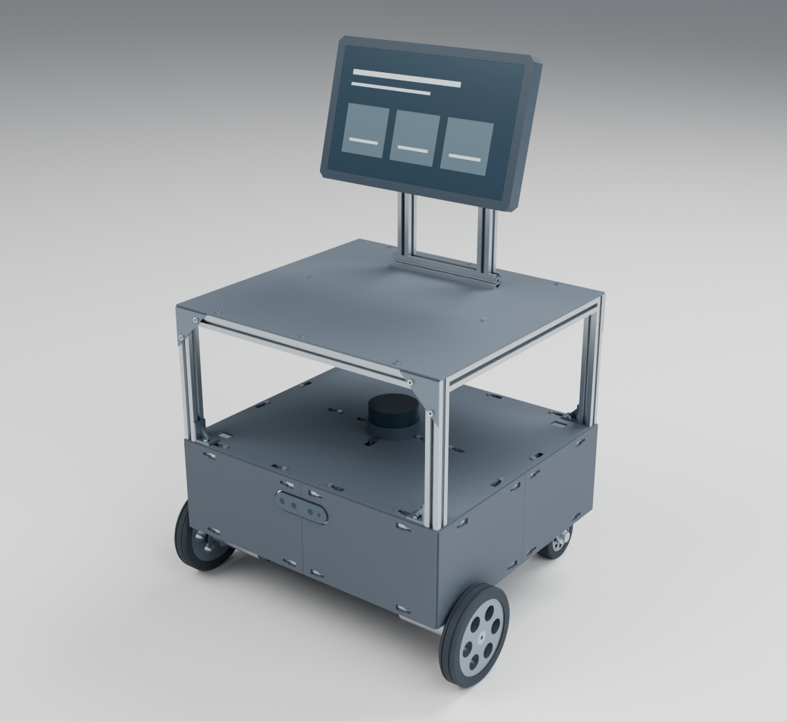

  

<h1 align="center">Oh My MobileRobot</h1>

  <em>A mobile robot base and extension modules.</em>

  <a href="#completed-robot">Photos</a> ·
  <a href="docs/full-model.en.md">Full model</a> ·
  <a href="docs/parts.en.md">CAD · STL</a> ·
  <a href="docs/ros.en.md">ROS · ROS 2</a> ·
  <a href="docs/design.en.md">Design specifications</a> ·
  <a href="docs/components.en.md">Components</a>

  <a href="README.md">한국어</a> · <strong>English</strong>

---

**Oh My MobileRobot** is a mobile robot hardware project with a 2020 aluminum extrusion frame, drive wheels, rear casters, and 3D printed deck panels, covers, and sensor mounts.

This repository provides CAD and ROS models of the base and application concepts, part design files, printable STLs, and drawings. Component placement, mounting methods, and upper modules can be adapted around the base frame to suit the application.

## Completed robot

   
  Front view of the completed base

| Front perspective | Side and top deck |
| :---: | :---: |
|  |  |

The photographs show the earlier deck with round holes. The current design files use T-nut insertion keyholes and 16 frame fasteners.

## Base platform

   
  Rendered from the exterior CAD model

The frame consists of upper and lower rectangular frames joined by vertical corner members. The central upper cross rail carries the LiDAR mount. The base has no raised posts at the four deck corners.

### Base specifications

| Item | Specification |
| --- | --- |
| Frame envelope | **440 × 400 × 140 mm**, including extrusions; drawing coordinates X × Y × Z |
| Frame members | 2020 aluminum extrusions, 20 × 20 mm section |
| Drive wheels | Two, left and right near the front |
| Rear support | Two casters |
| Exterior panels | Four deck quadrants and split side covers |

## Hardware configuration

| Group | Components | Placement and role |
| --- | --- | --- |
| Drive and support | DFRobot KIT0085, metal motor brackets, rear casters | Drive-wheel mounting and base support |
| Range and depth sensors | RPLIDAR A2M12, RealSense D435i | Range measurement and depth imaging |
| Computing and control | Jetson Orin Nano Super, Arduino Mega 2560, NT-S-DCDM1210 | Main computer, microcontroller, and motor driver |
| IMU | HFI-A9 | Inertial measurement |
| Power conversion | SZH-EKBD-058, LTC3780 SZH-EK334 | DC-DC power conversion |

The mechanical structure combines the extrusion frame with split covers and sensor brackets. The electronics use two tray levels joined by metal PCB standoffs.

## Application concepts

The three concepts combine application modules with a **shared third-level platform supported by four posts above the LiDAR deck**.

| Cargo carrier | Six-axis robot arm | Information display |
| :---: | :---: | :---: |
|  |  |  |
| Extrusion rim and sheet-panel cargo space | Industrial-style six-axis arm with a two-finger gripper | A guidance screen on an extrusion mast |

See the [complete model document](docs/full-model.en.md#application-concepts) for post and upper-frame construction and layout dimensions.

## ROS and ROS 2 models

The base and three application concepts are also available as **URDFs, a common Xacro, and visual meshes**. The models contain drive-wheel and caster joints and LiDAR and camera frames, with ROS 1 and ROS 2 launch files for viewing in RViz.

See [ROS and ROS 2 model usage](docs/ros.en.md) for package installation, model selection, coordinate conventions, and connecting real joint states.

## Documents and files

| Document | Contents |
| --- | --- |
| [Complete model structure and layout](docs/full-model.en.md) | Exterior views, coordinate system, component positions, and extension structures |
| [Design file index](docs/parts.en.md) | CAD, STL, drawing, and ROS package downloads, plus source file contents |
| [Printed part design specifications](docs/design.en.md) | Panel dimensions, mounting holes, fasteners, and electronics tray layout |
| [Purchased component specifications](docs/components.en.md) | Purchased component models, quantities, and product dimensions |
| [Printing instructions](docs/printing.en.md) | STL orientations, fit coupon usage, and PDF print settings |
| [ROS and ROS 2 model usage](docs/ros.en.md) | Package build and launch, model selection, TF frames, and regeneration |
| [Design references](docs/references.md) | Manufacturer data, product drawings, and project dimension sources |

## License

Original CAD, printable geometry, ROS models and conversion tools, drawings, and documentation are available under [CERN-OHL-P-2.0](LICENSE). See [NOTICE](NOTICE.md) for attribution and scope.
