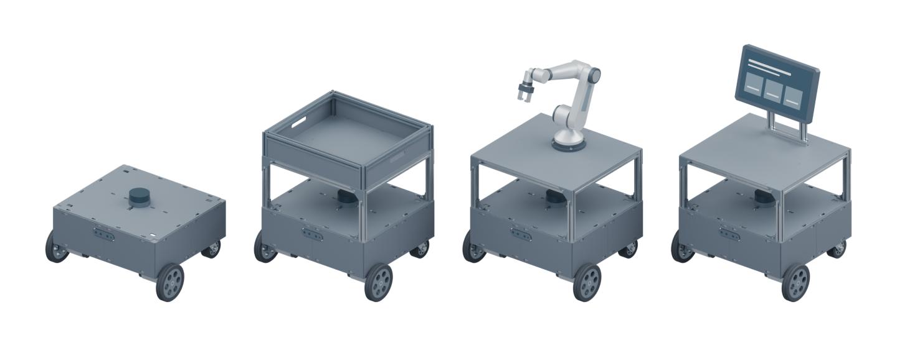
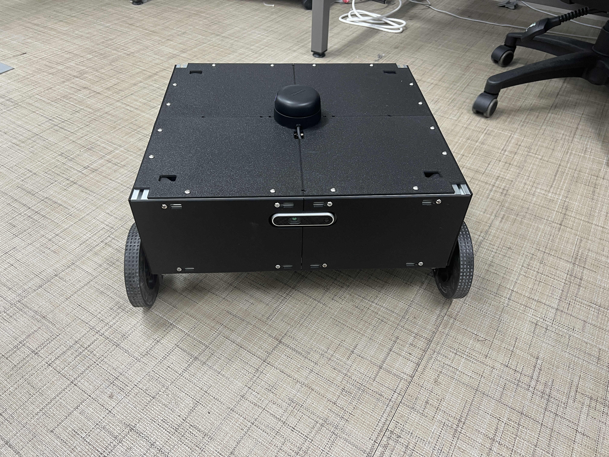
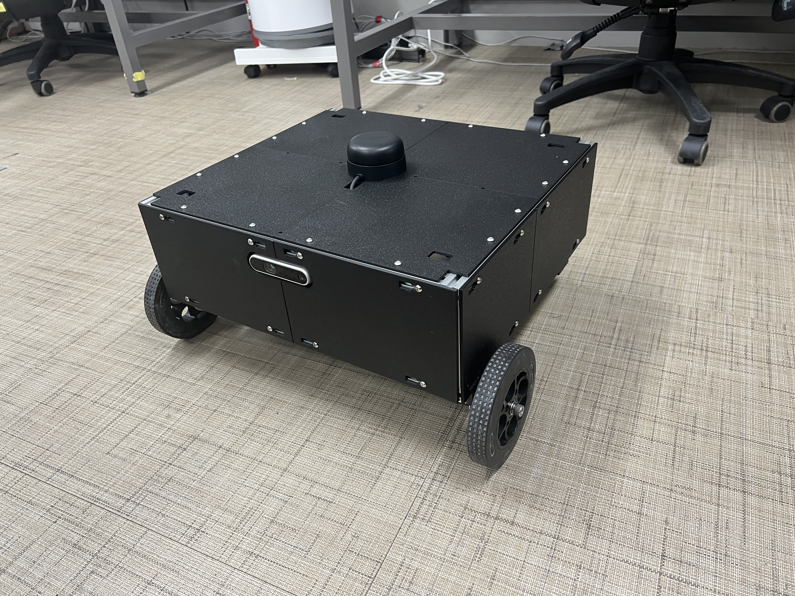
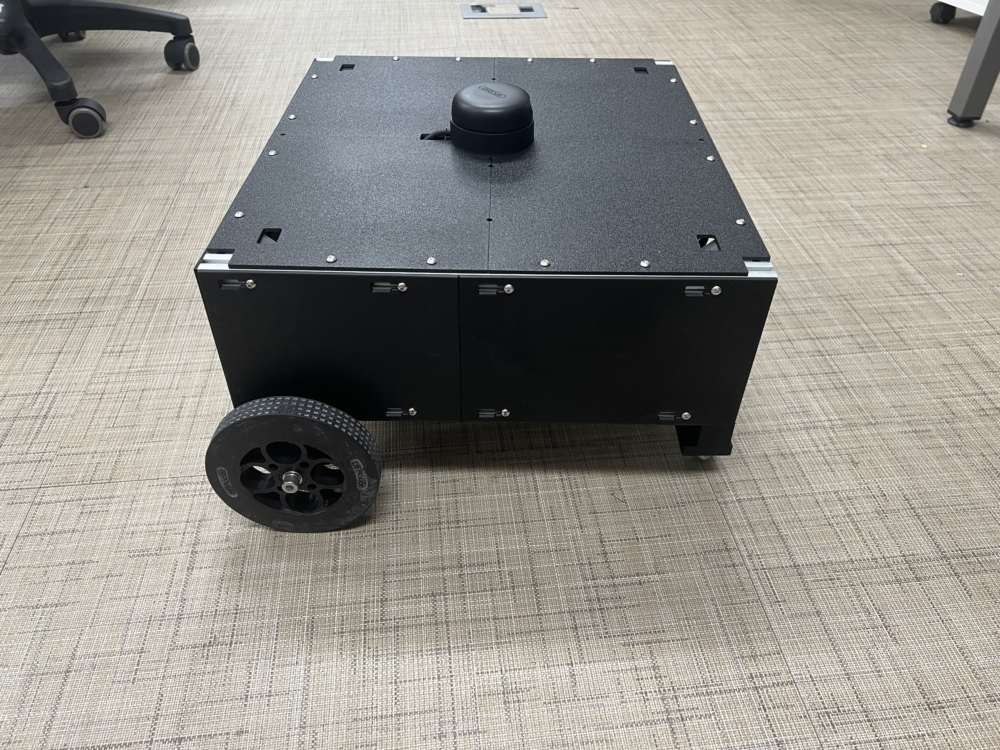
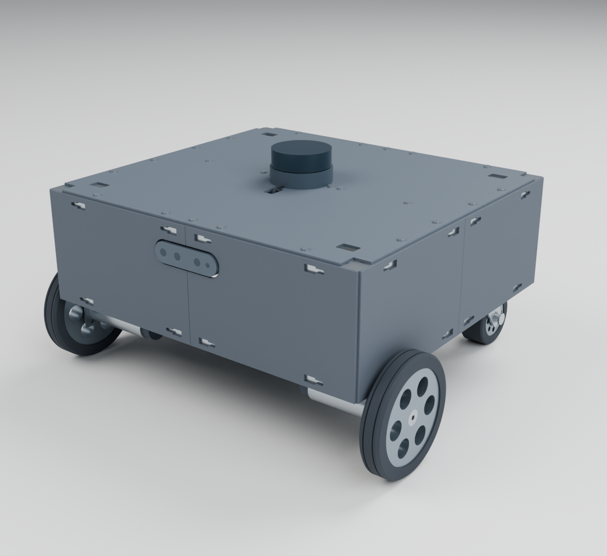
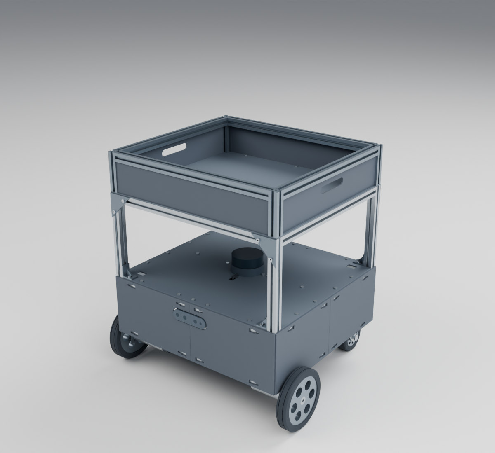
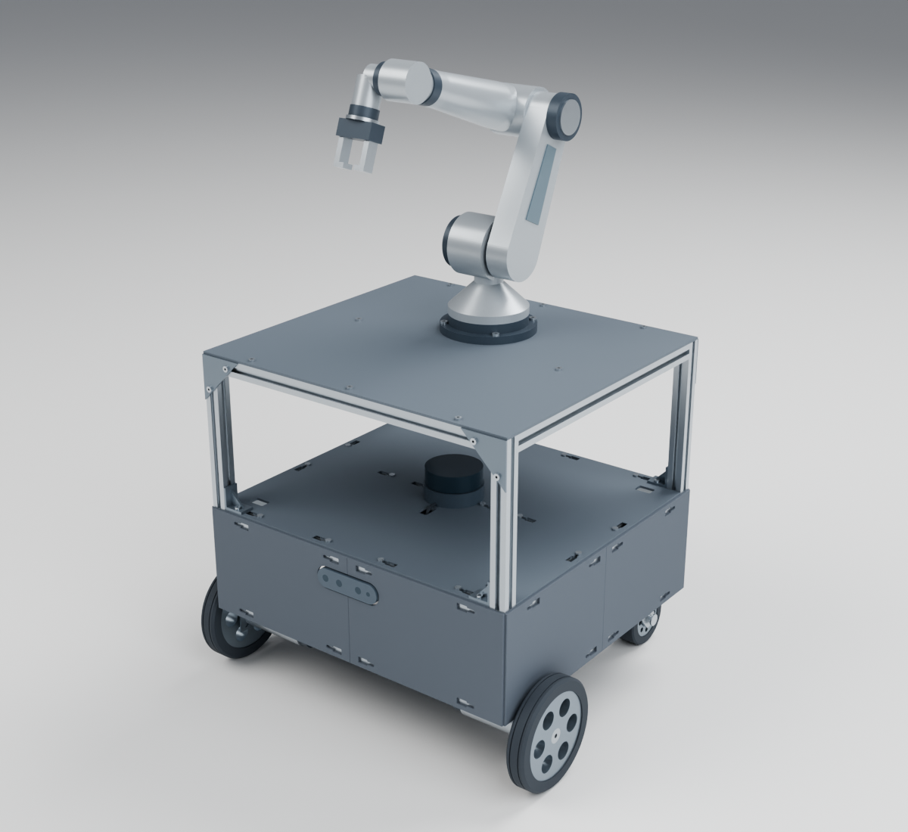
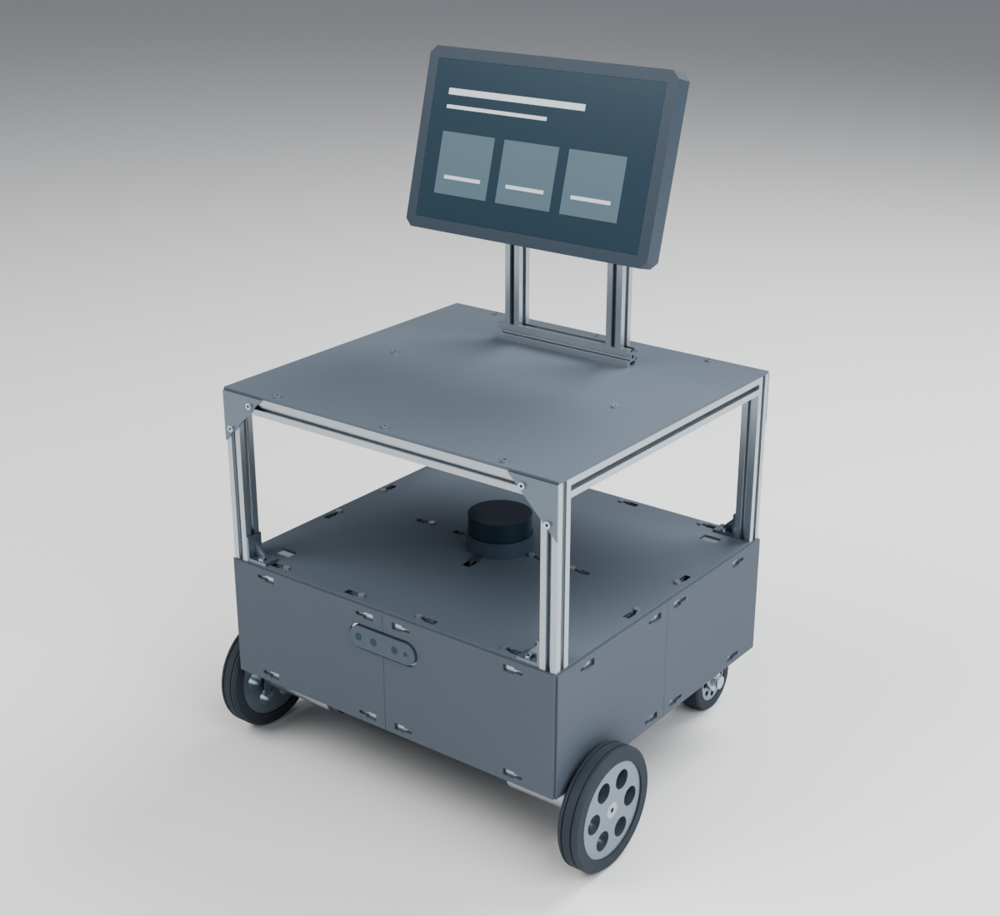

<p align="center">
  
</p>

<h1 align="center">Oh My MobileRobot</h1>

<p align="center">
  <em>2020 알루미늄 프로파일과 3D 프린팅 외장 기반의 오픈소스 모바일 로봇 하드웨어 · URDF 모델</em>
</p>

<p align="center">
  <a href="#overview">프로젝트 구성</a> ·
  <a href="#completed-robot">완성 사진</a> ·
  <a href="#robot-video">주행 영상</a> ·
  <a href="docs/full-model.ko.md">전체 형상</a> ·
  <a href="docs/parts.ko.md">CAD · STL</a> ·
  <a href="docs/ros.ko.md">ROS · ROS 2</a> ·
  <a href="docs/design.ko.md">설계 규격</a> ·
  <a href="docs/components.ko.md">구매 부품</a>
</p>

<p align="center">
  <strong>한국어</strong> · <a href="README.en.md">English</a>
</p>

---

**Oh My MobileRobot**은 표준 2020 알루미늄 프로파일 프레임에 양륜 차동 구동부, 후방 캐스터, 3D 프린팅 외장·센서 마운트를 결합한 **모바일 로봇 하드웨어 설계 및 ROS 모델 저장소**입니다.

이 저장소에서 제공하는 핵심 자산은 다음 세 가지입니다.

- **제작 가능한 기구 설계**: 분할 상판·측면 커버·카메라 브라켓·2층 전장판의 **원본 CAD(`.sc`, `.step`)**, **3D 프린팅용 STL**, **1:1 도면(PDF)**, **구매 부품 명세(BOM)**
- **모듈형 상부 확장 구조**: 기본 베이스(`base`) 위에 공통 3층 플랫폼을 결합해 **적재함(`cargo`)**, **6축 로봇암(`arm`)**, **안내 디스플레이(`display`)**로 확장하는 참조 설계
- **ROS · ROS 2 로봇 모델**: RViz 시각화와 TF 트리 구성을 바로 실행할 수 있는 `oh_my_mobilerobot_description` 패키지(URDF, 공통 Xacro, 시각화·충돌 메시)

<a id="overview"></a>

## 전체 프로젝트 구성 (Oh My MobileRobot 생태계)

본 로봇 프로젝트는 **기구 설계 → 하위 제어·보정 → 상위 ROS 2 자율주행**의 3단계 저장소로 구성되어 있습니다.

| 단계 | 저장소 | 담당 역할 및 주요 내용 |
| --- | --- | --- |
| **1. 하드웨어 · 모델** | **`Oh-My-MobileRobot`** *(현재 저장소)* | 2020 프로파일 프레임, 3D 프린팅 외장 CAD·STL·도면, 구매 부품(BOM), ROS 1/2 URDF 모델 |
| **2. 하위 제어 · 진단** | [`Oh-My-Control`](https://github.com/Leehyunbin0131/Oh-My-Control) | Arduino Mega 1 kHz 폐루프 모터 제어 펌웨어, 모터 PID·IMU 정지 보정, Jetson Orin 수동 조종 및 터미널 진단(TUI) |
| **3. 자율주행 (SLAM · Nav2)** | [`Oh_My_SLAM`](https://github.com/Leehyunbin0131/Oh_My_SLAM) | 구동 제어기–ROS 2 브리지, Gazebo 시뮬레이션, 실물 2D SLAM(`slam_toolbox` / `AMCL`) 및 `Nav2` 자율주행 통합 |

<a id="completed-robot"></a>

## 실제 완성 모습

<p align="center">
  <br>
  <sub>완성된 기본 베이스의 전면</sub>
</p>

| 전면 사시 | 측면·상판 |
| :---: | :---: |
|  |  |

사진은 기존 원형 홀 상판이며, 현재 설계 파일은 T너트 삽입 키홀과 프레임 체결 16개를 적용한 상판입니다.

<a id="robot-video"></a>

### 주행 영상

<table align="center"><tr><td>

https://github.com/user-attachments/assets/bb98cf7c-ee6c-49f0-b458-9154ca7bda5a

</td></tr></table>

## 기본 베이스

<p align="center">
  <br>
  <sub>전체 외형 CAD 모델의 렌더링 이미지</sub>
</p>

프레임은 상·하부 사각 프레임과 모서리 수직 부재로 구성됩니다. 상부 중앙 가로 프로파일에는 라이다 고정부가 연결됩니다. 기본 베이스는 상판 위로 올라오는 네 모서리 기둥이 없는 형태입니다.

### 기본 사양

| 항목 | 사양 |
| --- | --- |
| 프레임 외곽 | **440 × 400 × 140 mm** — 프로파일 포함, 도면 좌표 X × Y × Z |
| 프레임 부재 | 2020 알루미늄 프로파일, 20 × 20 mm 단면 |
| 구동 바퀴 | 전면 쪽 좌·우 2개 |
| 후방 지지 | 캐스터 2개 |
| 외장 구성 | 4분할 상판과 분할 측면 커버 |

## 하드웨어 구성

| 구분 | 구성 | 배치·역할 |
| --- | --- | --- |
| 구동·지지 | DFRobot KIT0085, 금속 모터 브라켓, 후방 캐스터 | 구동 바퀴 고정과 베이스 지지 |
| 거리·깊이 센서 | RPLIDAR A2M12, RealSense D435i | 거리 측정과 깊이 영상 |
| 연산·제어 | Jetson Orin Nano Super, Arduino Mega 2560, NT-S-DCDM1210 | 메인 연산, 마이크로컨트롤러, 모터 드라이버 |
| IMU | HFI-A9 | 관성 측정 |
| 전원 변환 | SZH-EKBD-058, LTC3780 SZH-EK334 | DC-DC 전원 변환 |

기구부는 프로파일 프레임에 분할 외장과 센서 브라켓을 결합한 구조입니다. 전장부는 금속 PCB 서포터로 연결된 2층 전장판을 사용합니다.

## 확장 예시

세 가지 개념 모델은 **라이다 층에서 네 기둥으로 올린 공통 3층 플랫폼**에 용도별 모듈을 결합한 형태입니다.

| 적재함형 | 6축 로봇암형 | 안내 디스플레이형 |
| :---: | :---: | :---: |
|  |  |  |
| 프로파일 테두리와 판재로 만든 적재 공간 | 산업용 6축암 형태와 두 손가락 그리퍼 | 프로파일 마스트에 고정한 안내 화면 |

각 예시의 기둥·상부 프레임 구성과 배치 치수는 [전체 모델 문서](docs/full-model.ko.md#application-concepts)에 있습니다.

## ROS·ROS 2 모델 (`oh_my_mobilerobot_description`)

기본 베이스(`base`)와 세 가지 확장 예시(`cargo`, `arm`, `display`)는 **URDF·공통 Xacro·시각화 메시**로 제공됩니다. 구동 바퀴·캐스터 회전 관절과 라이다·카메라 TF 좌표계가 정의되어 있어 ROS 1 및 ROS 2 환경의 RViz에서 즉시 확인할 수 있습니다.

```bash
# ROS 2 워크스페이스에서 RViz 모델 확인 예시 (variant: base | cargo | arm | display)
colcon build --symlink-install --packages-select oh_my_mobilerobot_description
source install/setup.bash
ros2 launch oh_my_mobilerobot_description display.launch.py variant:=base
```

상세한 패키지 설치, 좌표계 정의(`base_footprint`, `base_link`, 센서 프레임), 실제 로봇 관절 상태(`/joint_states`) 연결 방법은 [ROS·ROS 2 모델 사용](docs/ros.ko.md) 문서를 참고하세요.

## 문서와 파일

| 문서 | 제공 내용 |
| --- | --- |
| [전체 모델 구성과 배치](docs/full-model.ko.md) | 외형 뷰, 좌표 기준, 부품 위치와 확장 구조 |
| [설계 파일 목록](docs/parts.ko.md) | CAD·STL·도면·ROS 패키지 다운로드와 원본 파일 구성 |
| [출력 부품 설계 규격](docs/design.ko.md) | 판 치수, 장착홀, 볼트 규격과 전장판 배치 |
| [구매 부품 사양](docs/components.ko.md) | 구매 부품의 모델·수량·제품 규격 |
| [출력·인쇄 방법](docs/printing.ko.md) | STL 출력 방향, 시험편 사용과 PDF 인쇄 설정 |
| [ROS·ROS 2 모델 사용](docs/ros.ko.md) | 패키지 빌드·실행, 모델 선택, TF 좌표계와 재생성 |
| [자료 출처](docs/references.md) | 제조사 자료, 제품 도면과 프로젝트 치수의 출처 |

## 라이선스

원본 CAD, 출력 형상, ROS 모델·변환 도구, 도면과 문서에는 [CERN-OHL-P-2.0](LICENSE)을 적용합니다. 출처와 적용 범위는 [NOTICE](NOTICE.md)에 있습니다.
