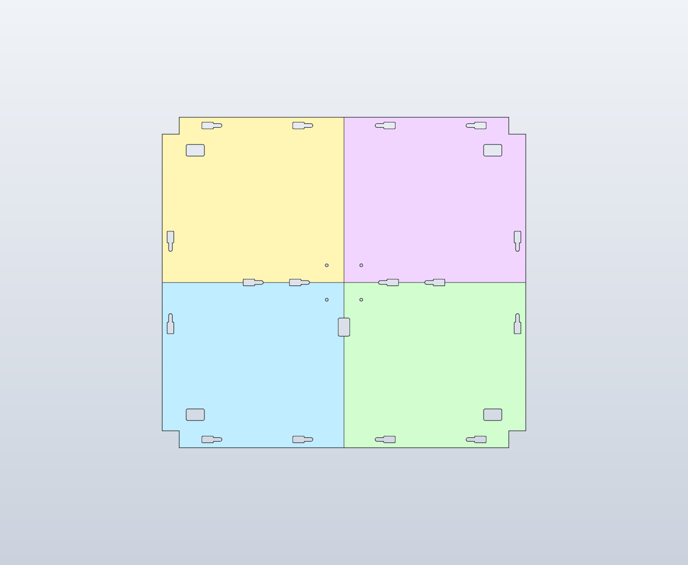
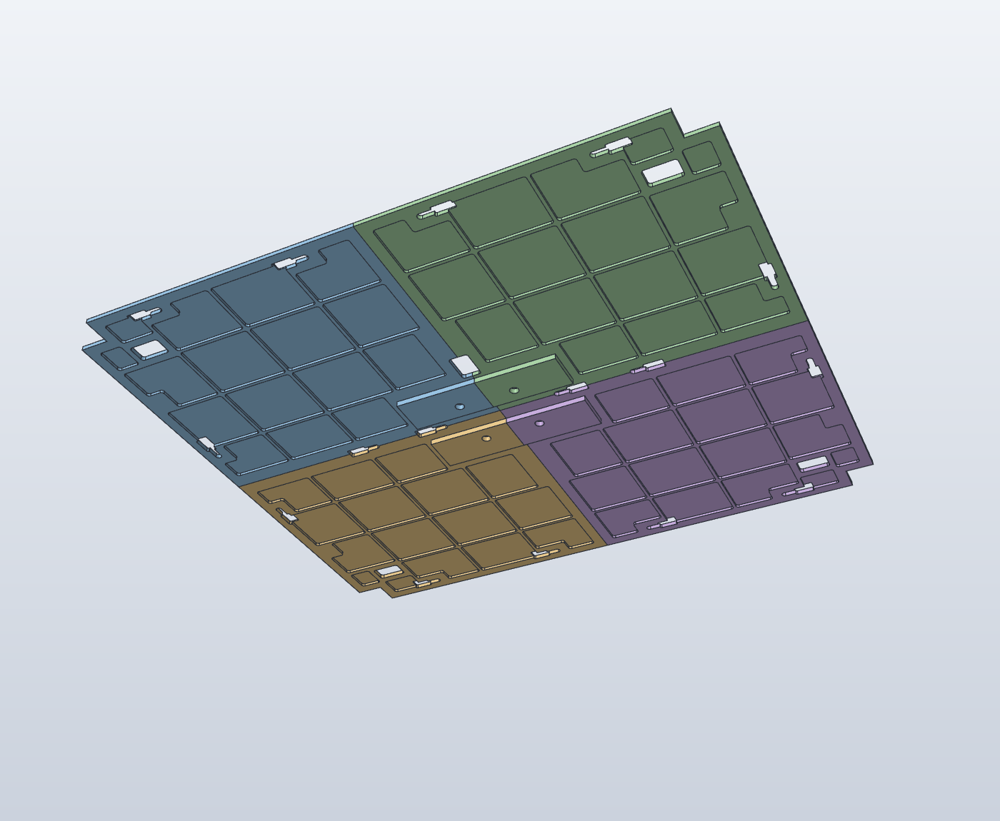
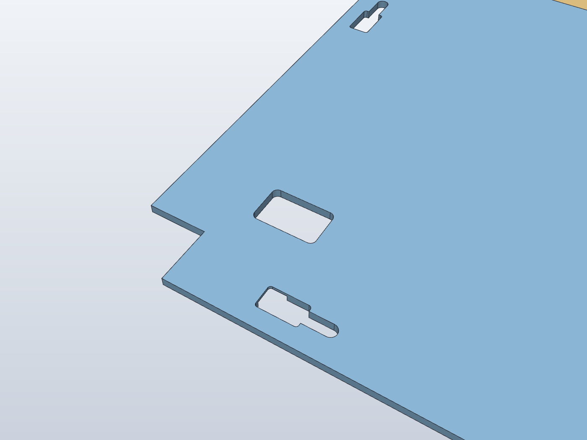
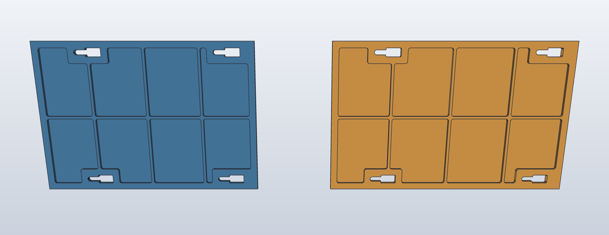
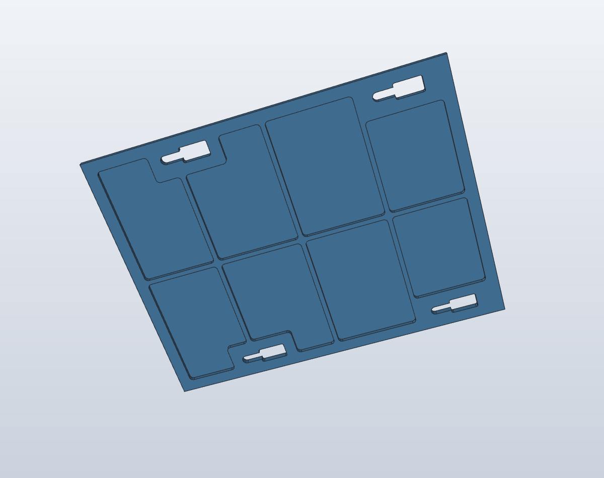
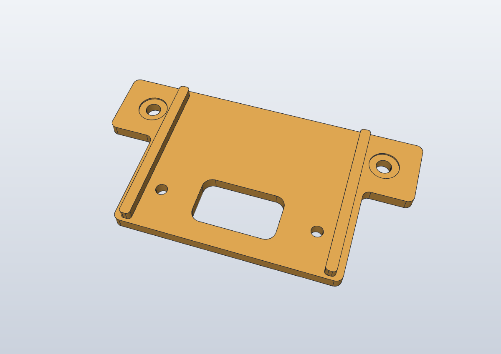
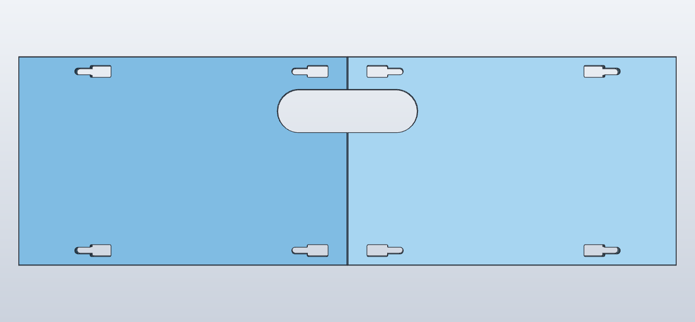
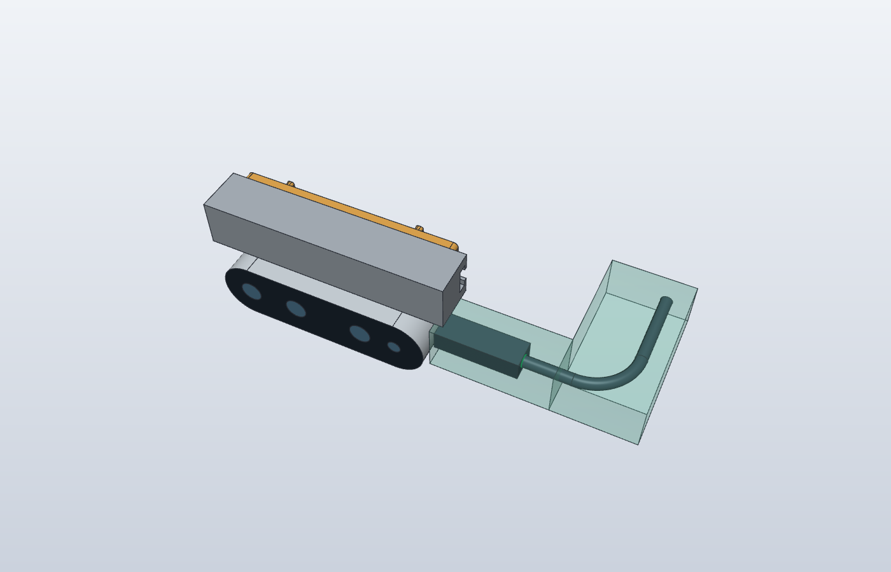
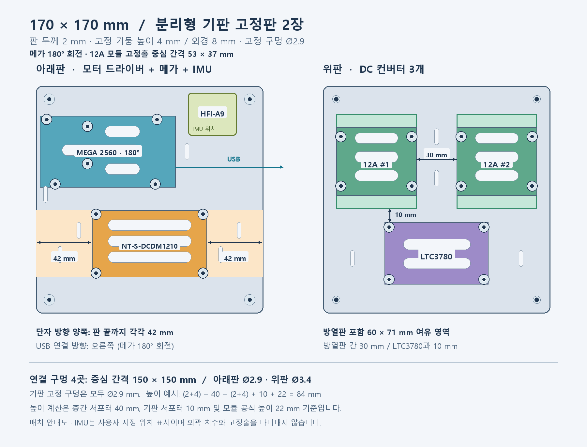
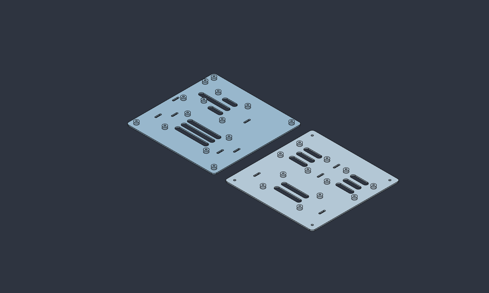

# Printed part design specifications

[English README](../README.en.md) · [한국어](design.ko.md) · [File index](parts.en.md) · [ROS models](ros.en.md)

This document covers printed geometry, mounting holes, fasteners, and electronics tray layout. Dimensions are in mm; individual CAD files may use local coordinates different from the [complete model coordinates](full-model.en.md#base-platform).

## Top deck — A2M12 / XT60

| Four-quadrant top layout | Underside reinforcement ribs | Corner XT60 and keyhole detail |
| :---: | :---: | :---: |
|  |  |  |

| Item | Dimension / specification |
| --- | --- |
| Split | Four quadrants meeting at X=220 and Y=200 |
| Each panel | 220 × 200; regular areas up to 3 thick |
| Skin and ribs | 1 mm skin, 2 mm underside ribs |
| Central reinforcement | Combined 120 × 80 area; up to 7 thick |
| Central rail channel | 20.4 wide; 0.2 clearance on each side of the 2020 rail |
| Frame fasteners | 16 M4 × 8 bolt / M4 hammer T-nut sets: three perimeter anchors per panel and four shared center anchors |
| T-nut keyholes | 14 × 8 entry, R1; 4.5 throat width; 15 from entry center to fastening center |
| Reference T-nut envelope | 10 × 6 × 3.5; hammer type compatible with the extrusion slot |
| A2M12 fasteners | Four M3 × 6 flat-underhead screws, inserted from below |
| LiDAR holes | Ø3.4; underside head recess Ø6.5 × 4 deep; 3 mm bearing thickness |
| LiDAR hole pattern | Center (220,200), radius 29.5, starting at 45° with 90° spacing |
| X/Y hole pitch | 41.7193 |
| LiDAR screw insertion | Nominal 3; manufacturer maximum 4 |
| Corner interfaces | 20.5 × 20.5 at each outside corner |
| XT60 openings | 22 × 14, R2; centers 40 inward along both axes from each outside corner |
| XT60 centers | (40,40), (400,40), (40,360), (400,360) |
| XT60 surrounding land | 3 thick; minimum 9 clearance from perimeter frame rails |
| LiDAR cable opening | Center (220,146), 14 × 22, R2 |

The four panels carry the central reinforcement directly; there is no separate central saddle. Four anchors fasten to the center rail. Each central keyhole and bolt head spans the adjoining front and rear panels. See the [complete model](full-model.en.md#base-platform) for the base and extension post configurations.

Insert a hammer T-nut loosely threaded onto its bolt through the wide entry from above and turn it into the extrusion slot. Keep the panels in position, slide the bolt and nut 15 along the slot to the narrow fastening end, then tighten. The bearing land is 3 thick. The entry remains open after fastening.

The XT60 openings are for passing standard XT60/XT60H cable connectors lengthwise. The vertical clearance envelope verified in CAD has an 18 × 11 cross section.

[Top-deck files](parts.en.md#printed-parts)

## Side panels

| 200 / 220 mm side panels | 180 mm side panel |
| :---: | :---: |
|  |  |

Plain panels measure 200 × 140 or 220 × 140. A 1 mm outer skin and 2 mm inner ribs give a 3 mm maximum thickness, without ventilation openings. The extra 180 mm panel uses the same thickness layout and measures 180 × 140 × 3 maximum.

Each panel has four keyholes for M4 hammer T-nuts. The entry is 14 × 8, the narrow section is 4.5 wide, and the travel between entry and fastening centers is 15. The design reference T-nut envelope is 10 × 6 × 3.5.

The 200/220 filenames refer to panel length. Two 200 mm panels cover one 400 mm frame face, and two 220 mm panels cover one 440 mm face.

[Side-panel files](parts.en.md#printed-parts)

## D435i camera and front panels

| D435i V2 bracket | Front left/right cover opening | USB-C plug and cable clearance |
| :---: | :---: | :---: |
|  |  |  |

The camera is horizontal and looks straight forward. Its weight is carried by the bracket fastened to the inner face of the upper extrusion, not by the thin front covers.

| Item | Dimension / specification |
| --- | --- |
| Front panels | Left/right: 220 × 140 each, up to 3 thick with 1 mm skin |
| Combined camera opening | 94 × 29; center 220 from the left and 103.5 from the bottom |
| Camera front projection | Nominal 2.05 beyond the outer cover face |
| Camera-to-upper-rail gap | 4 between camera top and rail underside |
| V2 bracket | 92 × 49 × 6.5; main body thickness 3.5 |
| Camera fasteners | Two M3 × 6; rear hole pitch 45; nominal insertion 2.5, maximum 3 |
| Extrusion fasteners | Two M4 × 8 / T-nut sets; hole pitch 72 |
| Projection into extrusion | 5 with a 3 mm bearing thickness |
| Straight USB-C plug reserve | 50 × 20 × 20 on each side of the camera |
| Cable turning reserve | 35 × 65 × 20 on each side |

The 5 mm top plate in the camera drawing is a part-specific reference configuration. Current deck dimensions are in [top-deck specifications](#top-deck). USB reserves are design clearance envelopes for a straight plug and the cable path. The V2 bracket starts from one closed outer sketch and one body extrusion, with subtractive relief leaving integral reinforcement.

[Camera files and source contents](parts.en.md#printed-parts)

## Electronics trays

| Electronics layout | Lower and upper tray 3D geometry |
| :---: | :---: |
|  |  |

The lower tray carries the NT-S-DCDM1210 motor driver and Arduino Mega. The upper tray carries two SZH-EKBD-058 modules and one LTC3780 SZH-EK334. The HFI-A9 IMU is installed in the upper-right free area beside Mega in the tray diagram. The diagram indicates the IMU location; the tray CAD has no dedicated mounting holes.

- Two 170 × 170 trays: 2 mm plate, 4 mm raised bosses, 8 mm boss outside diameter, 6 mm maximum printed height.
- M3 standoff holes: Ø2.9 through pilot holes, without threads. A 5 mm male thread has a nominal 1 mm tip allowance within the 6 mm distance from boss top to plate underside.
- Lower tray: 14 pilot holes/bosses. Upper tray: 12 pilot holes/bosses and four Ø3.4 inter-deck clearance holes.
- Inter-deck attachment pitch: 150 × 150. Long columns are not printed; metal PCB standoffs join the two trays.
- SZH-EKBD-058 hole pitch: **53 × 37**, corrected by the user. Heatsink reserve: 60 × 71 each, with 30 between the two modules.
- LTC3780 hole pitch: **71 × 39**, measured by the user. Clearance to each buck-module heatsink envelope: 10.
- Mega has the 180° orientation shown in the layout; USB faces local +X.
- With 40 mm inter-deck standoff bodies, 10 mm PCB standoffs, and a 22 mm upper module height, nominal stack height is 84.

[Tray files](parts.en.md#printed-parts)
