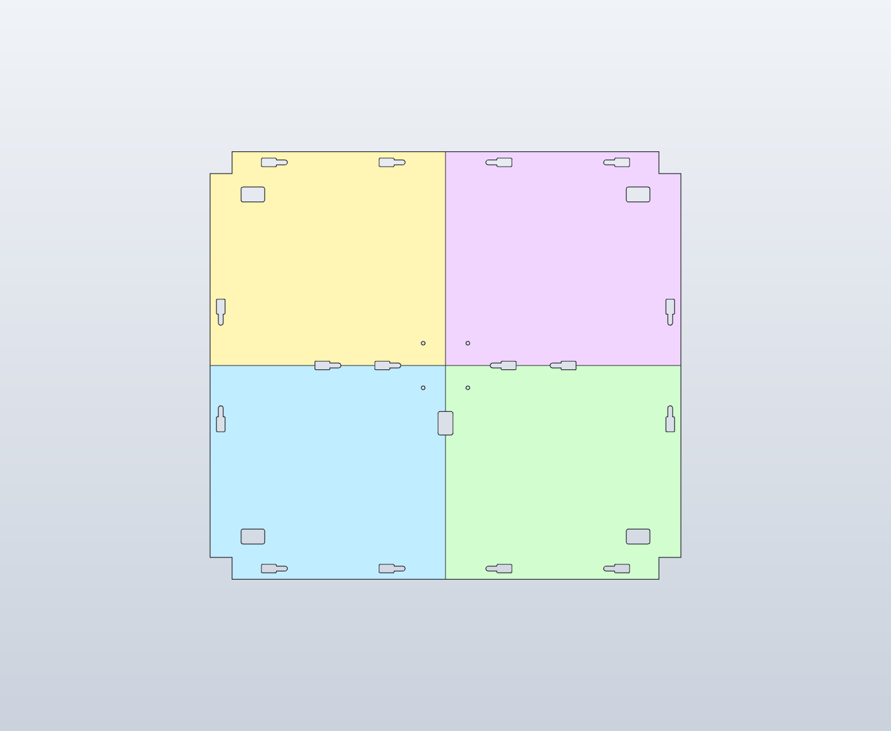
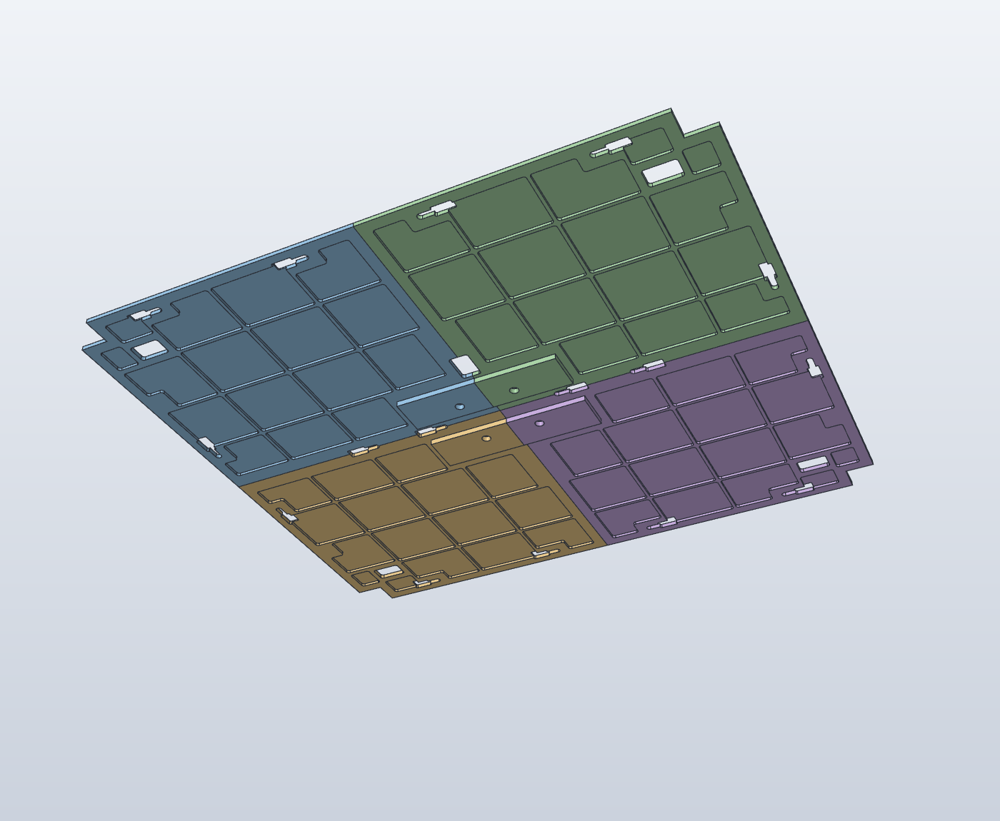
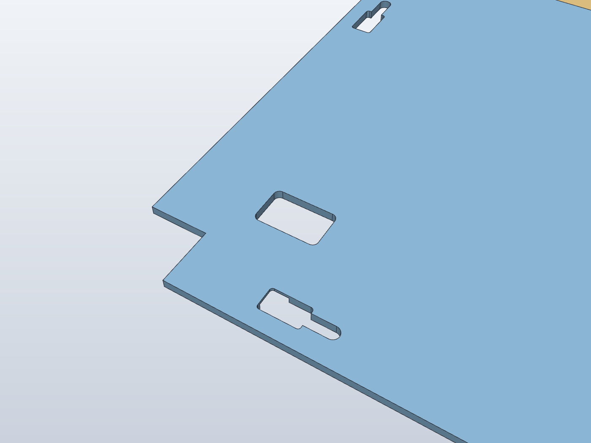
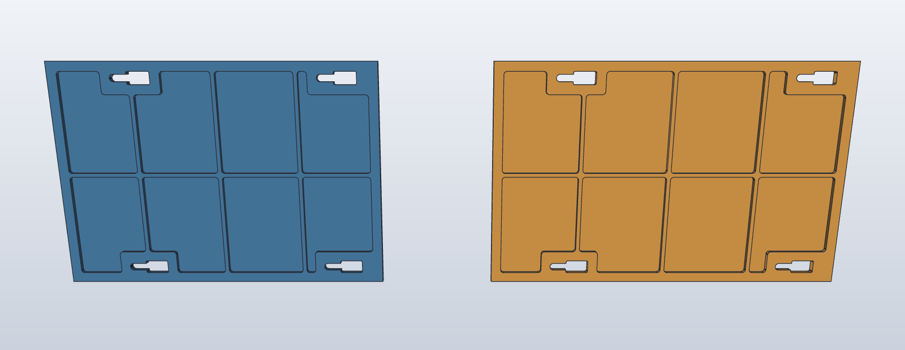
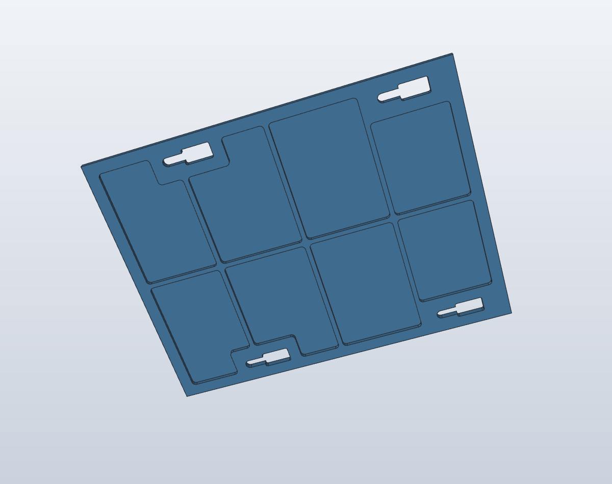
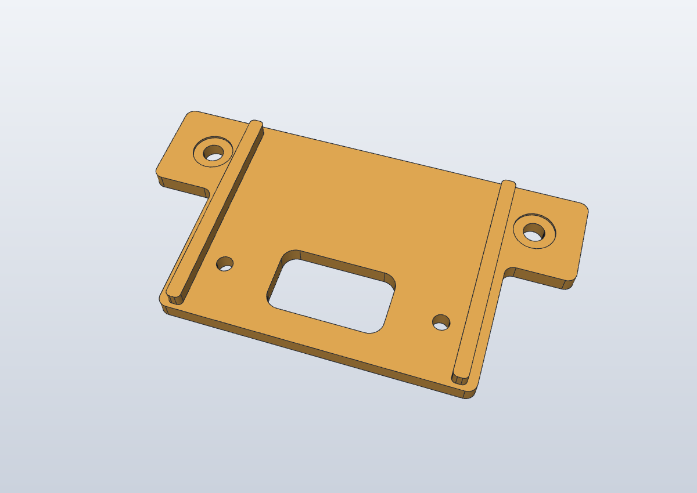
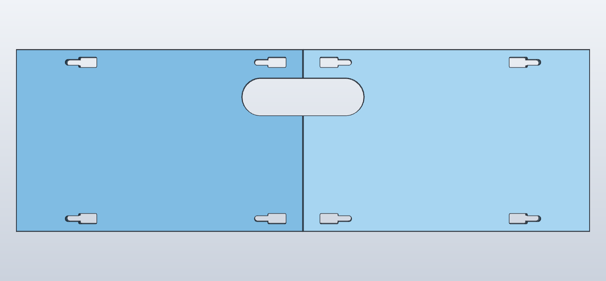
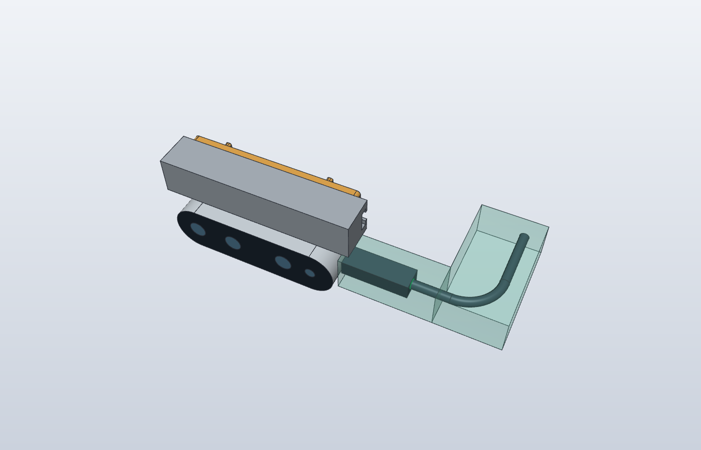
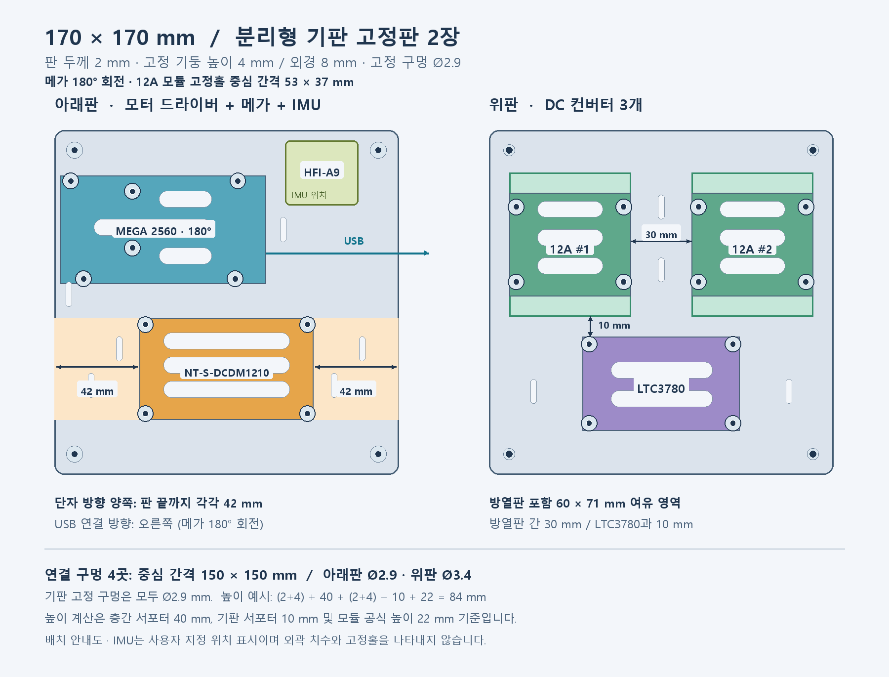
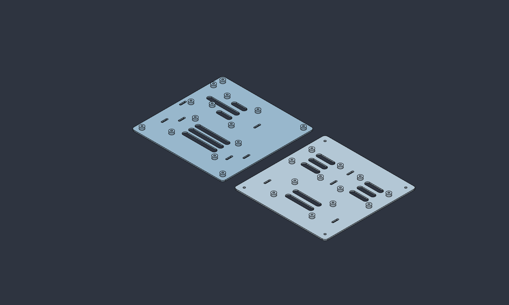

# 출력 부품 설계 규격

[한국어 README](../README.md) · [English](design.en.md) · [파일 목록](parts.ko.md) · [ROS 모델](ros.ko.md)

출력 부품의 형상·장착홀·체결부와 전장판 배치를 설명합니다. 치수는 mm이며, 개별 CAD의 로컬 좌표는 [전체 모델 좌표](full-model.ko.md#base-platform)와 다를 수 있습니다.

## 상판 — A2M12 / XT60

| 상면 4분할 배치 | 밑면 보강 리브 | 모서리 XT60·키홀 상세 |
| :---: | :---: | :---: |
|  |  |  |

| 항목 | 치수 / 규격 |
| --- | --- |
| 분할 | X=220, Y=200에서 정확히 네 조각 |
| 각 판 | 220 × 200 / 일반부 최대 두께 3 |
| 표면·리브 | 표면 1, 아래 리브 2 |
| 중앙 보강 | 전체 120 × 80 영역 / 최대 두께 7 |
| 중앙 프로파일 홈 | 폭 20.4, 중앙 2020 프로파일 양쪽 여유 각 0.2 |
| 프레임 체결 | M4 × 8 + M4 해머형 T너트 총 16세트 / 판마다 외곽 3곳, 중앙 공유 4곳 |
| T너트 삽입 키홀 | 삽입구 14 × 8, R1 / 목 폭 4.5 / 삽입 중심에서 체결 중심까지 15 |
| T너트 기준 외형 | 10 × 6 × 3.5 / 프로파일 홈과 호환되는 해머형 |
| A2M12 고정 | M3 × 6 일반 머리 4개, 아래에서 위로 체결 |
| 라이다 홀 | Ø3.4 / 아래 머리자리 Ø6.5, 깊이 4 / 남는 받침 두께 3 |
| 라이다 홀 패턴 | 중심 (220,200), 반경 29.5 원 위 45°부터 90° 간격 |
| 라이다 홀 X·Y 피치 | 41.7193 |
| 라이다 나사 삽입 | 명목 3 / 제조사 허용 최대 4 |
| 모서리 연결 자리 | 각 바깥 모서리 20.5 × 20.5 |
| XT60 구멍 | 22 × 14, R2 / 네 바깥 모서리에서 X·Y 각각 40 안쪽 |
| XT60 구멍 중심 | (40,40), (400,40), (40,360), (400,360) |
| XT60 구멍 둘레 | 두께 3 보강 / 프레임 외곽 레일과 최소 9 간격 |
| 라이다 배선구 | 중심 (220,146), 14 × 22, R2 |

상판은 중앙 보강부가 네 판에 통합된 구조로, 별도 중앙 받침은 없습니다. 중앙 프로파일에는 4곳을 체결하며, 각 키홀과 볼트 머리는 앞뒤 판이 절반씩 공유합니다. 기본 베이스와 확장 기둥 구성은 [전체 모델](full-model.ko.md#base-platform)에 있습니다.

키홀의 넓은 삽입구로 볼트에 느슨하게 끼운 T너트를 위에서 넣고, 프로파일 홈 안에서 체결 방향으로 돌립니다. 판을 움직이지 않고 볼트·T너트를 홈 방향으로 15 이동시켜 좁은 체결 끝에서 조입니다. 볼트 받침은 두께 3이며, 삽입구는 체결 후에도 열려 있습니다.

XT60 통과구는 일반 XT60/XT60H 케이블 단자를 길이 방향으로 통과시키는 용도입니다. CAD에서 확인된 수직 통과 여유 영역의 단면은 18 × 11입니다.

[상판 파일](parts.ko.md#printed-parts)

## 측면 판

| 200 / 220 mm 측면 판 | 180 mm 측면 판 |
| :---: | :---: |
|  |  |

일반 판은 200 × 140 또는 220 × 140입니다. 겉면 1, 안쪽 리브 2로 최대 두께는 3이며, 환기용 관통 구멍은 없습니다. 추가 180 mm 판도 180 × 140 × 최대 3으로 같은 두께 구성을 사용합니다.

각 판에는 M4 해머형 T너트 삽입용 키홀 4개가 있습니다. 삽입구 14 × 8, 좁은 부분 폭 4.5, 삽입 위치와 체결 중심 사이 이동량은 15입니다. 설계 기준 T너트 외형은 10 × 6 × 3.5입니다.

파일의 200/220 표기는 판의 길이입니다. 현재 프레임에서 200 mm 판 두 개가 400 mm 면 하나를, 220 mm 판 두 개가 440 mm 면 하나를 덮습니다.

[측면 판 파일](parts.ko.md#printed-parts)

## D435i 카메라와 전면 판

| D435i V2 브라켓 | 전면 좌·우 커버 개구부 | USB-C 플러그·케이블 여유 공간 |
| :---: | :---: | :---: |
|  |  |  |

카메라는 가로로 놓고 렌즈가 전면을 수평으로 향합니다. 카메라 무게는 프로파일 안쪽 면에 체결한 브라켓이 받으며, 얇은 전면 판에는 카메라를 고정하지 않습니다.

| 항목 | 치수 / 규격 |
| --- | --- |
| 전면 판 | 좌우 각 220 × 140, 최대 두께 3 / 표면 1 |
| 합쳐진 카메라 개구부 | 94 × 29 / 중심: 왼쪽에서 220, 아래에서 103.5 |
| 카메라 앞면 돌출 | 판 바깥면에서 명목 2.05 |
| 카메라와 상부 레일 | 카메라 윗면에서 레일 아랫면까지 4 |
| V2 브라켓 | 92 × 49 × 6.5 / 본체 두께 3.5 |
| 카메라 체결 | M3 × 6 두 개 / 후면 홀 피치 45 / 명목 삽입 2.5, 최대 허용 3 |
| 프로파일 체결 | M4 × 8 + M4 T너트 두 세트 / 홀 피치 72 |
| 프로파일 쪽 돌출 | 볼트 받침 두께 3 기준 5 |
| 일자형 USB-C 여유 | 카메라 양쪽에 플러그 공간 각 50 × 20 × 20 |
| 케이블 방향 전환 여유 | 양쪽 각 35 × 65 × 20 |

카메라 도면의 5T 상판은 부품별 참고 구성입니다. 현재 상판 치수는 [상판 규격](#top-deck)에 있습니다. USB 공간은 일자형 플러그와 케이블 경로를 위한 설계 여유 영역입니다. V2 브라켓은 하나의 닫힌 외곽 스케치에서 본체를 돌출한 뒤, 보강부를 남기도록 절삭한 단일 부품입니다.

[카메라용 파일과 원본 구성](parts.ko.md#printed-parts)

## 전장판

| 전장판 배치도 | 아래판·위판 3D 형상 |
| :---: | :---: |
|  |  |

아래판에는 NT-S-DCDM1210 모터 드라이버와 Arduino Mega, 위판에는 SZH-EKBD-058 두 개와 LTC3780 SZH-EK334 한 개의 고정 자리가 있습니다. HFI-A9 IMU는 아래판의 Mega 오른쪽 위 빈 공간에 설치되어 있습니다. 배치도는 IMU의 위치를 나타내며, 전장판 CAD에는 전용 고정홀이 없습니다.

- 판 두 장: 각각 170 × 170, 판 두께 2, 보스 높이 4, 보스 외경 8, 최대 출력 높이 6.
- M3 서포터용 구멍: 나사산이 없는 Ø2.9 관통 파일럿 홀. 수나사 길이 5 기준 보스 윗면에서 판 밑면까지 6이므로 나사 끝에 명목 1 여유가 있습니다.
- 아래판: 파일럿 홀·보스 14개. 위판: 파일럿 홀·보스 12개 + 층간 연결 Ø3.4 관통홀 4개.
- 층간 연결 중심 간격: 150 × 150. 층간 연결은 금속 PCB 서포터를 사용하며, 긴 기둥은 출력 대상이 아닙니다.
- SZH-EKBD-058 고정홀 피치: 사용자 정정값 **53 × 37**. 방열판 여유 영역 60 × 71, 두 모듈 사이 간격 30.
- LTC3780 고정홀 피치: 사용자 실측 **71 × 39**. 두 감압 모듈의 방열판 영역과 각각 10 간격.
- Mega는 배치도 기준 180° 회전 배치이며, USB는 전장판 로컬 +X 방향을 향합니다.
- 층간 서포터 몸통 40, 기판 서포터 10, 위쪽 모듈 높이 22 기준 명목 전체 높이는 84.

[전장판 파일](parts.ko.md#printed-parts)
