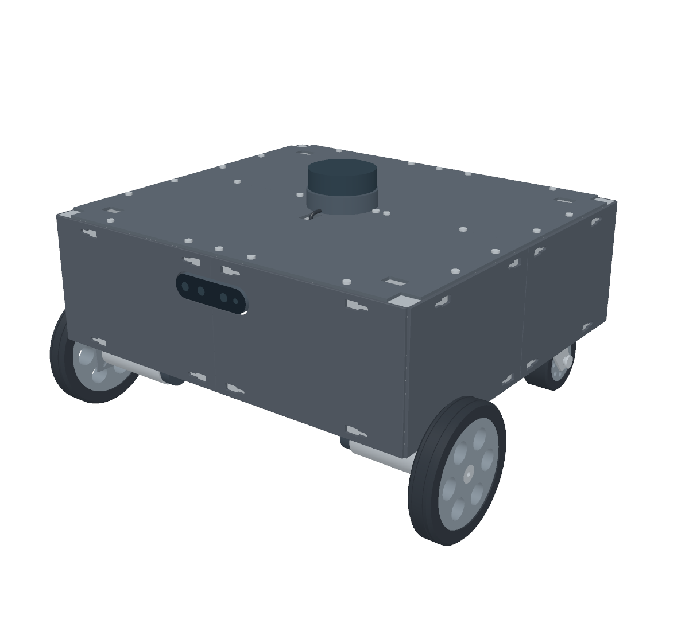
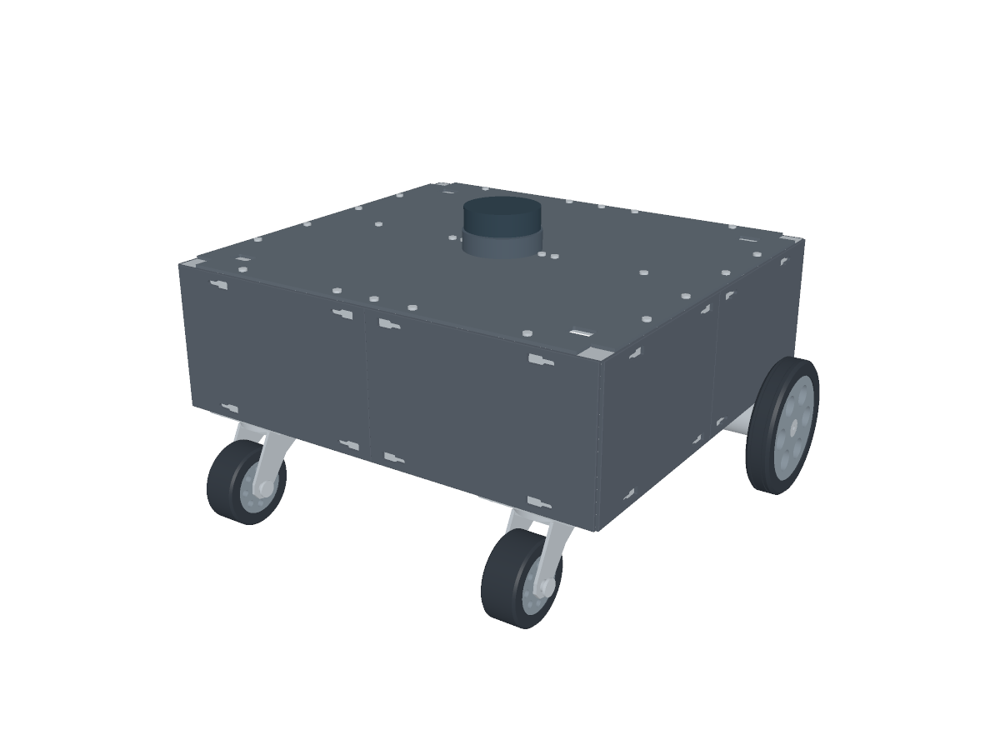
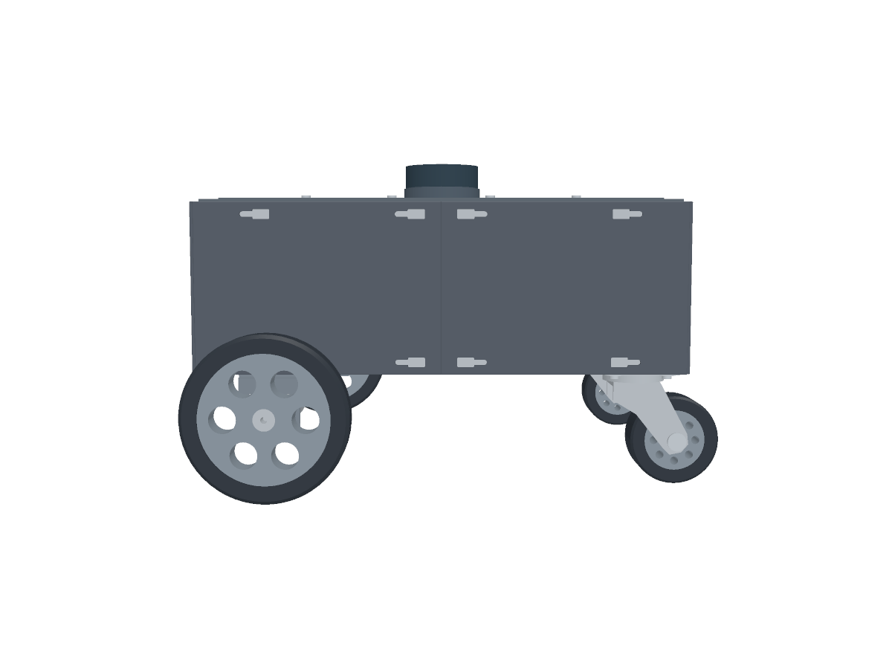
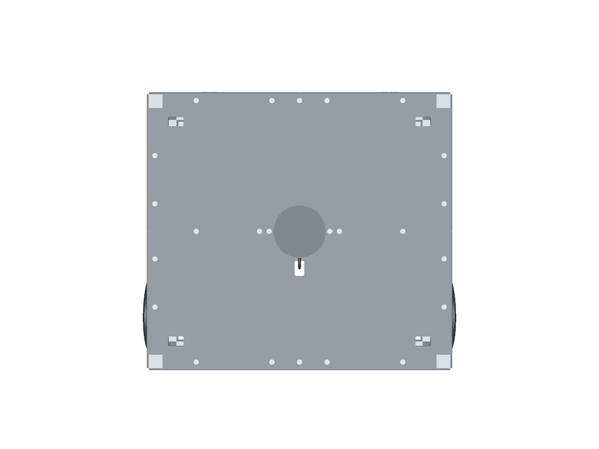
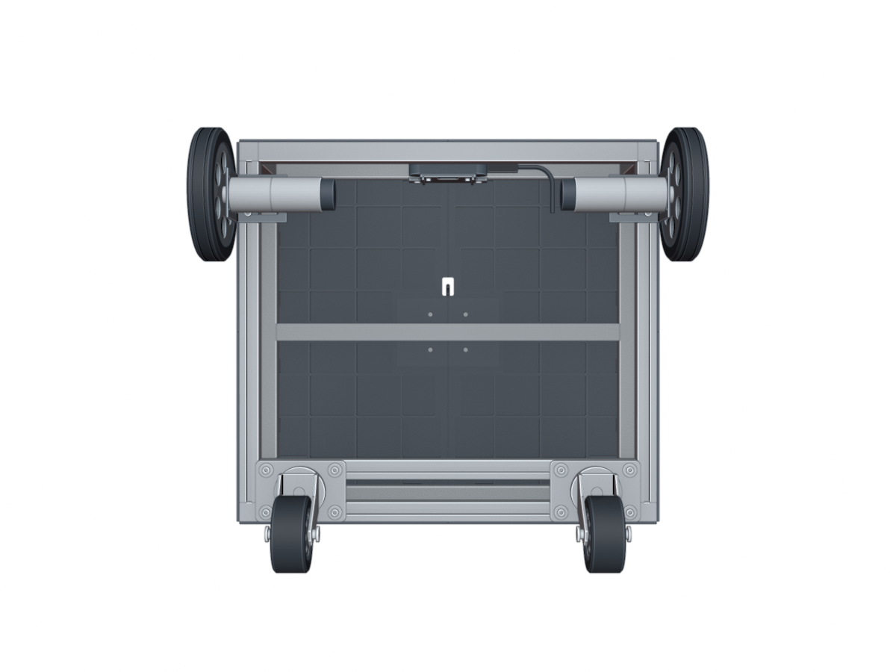
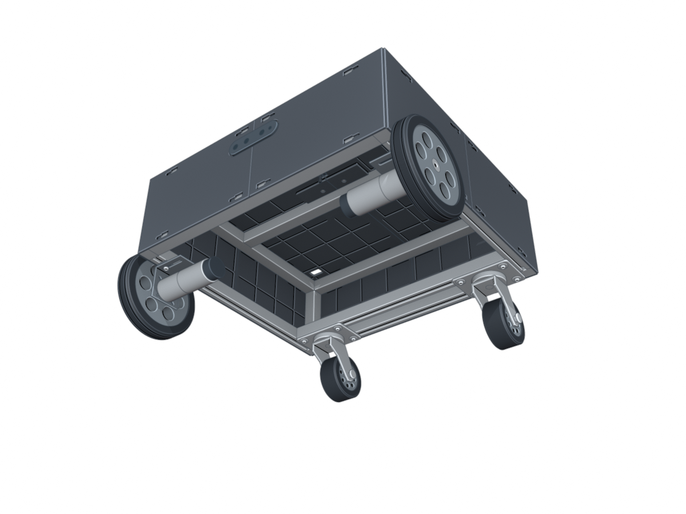
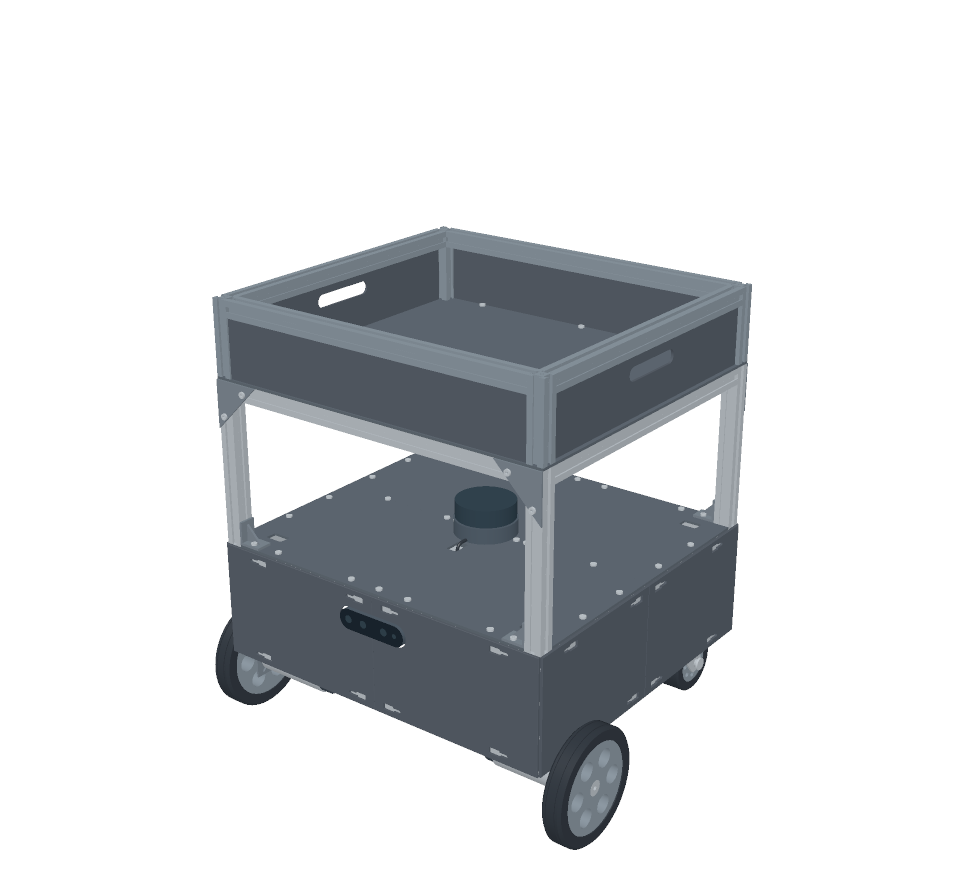
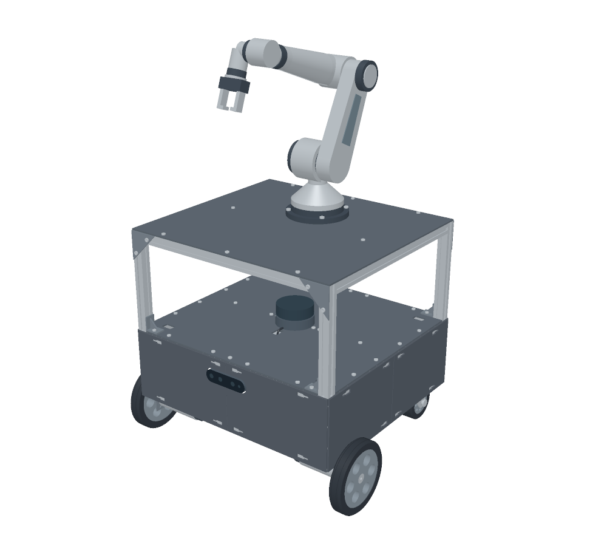
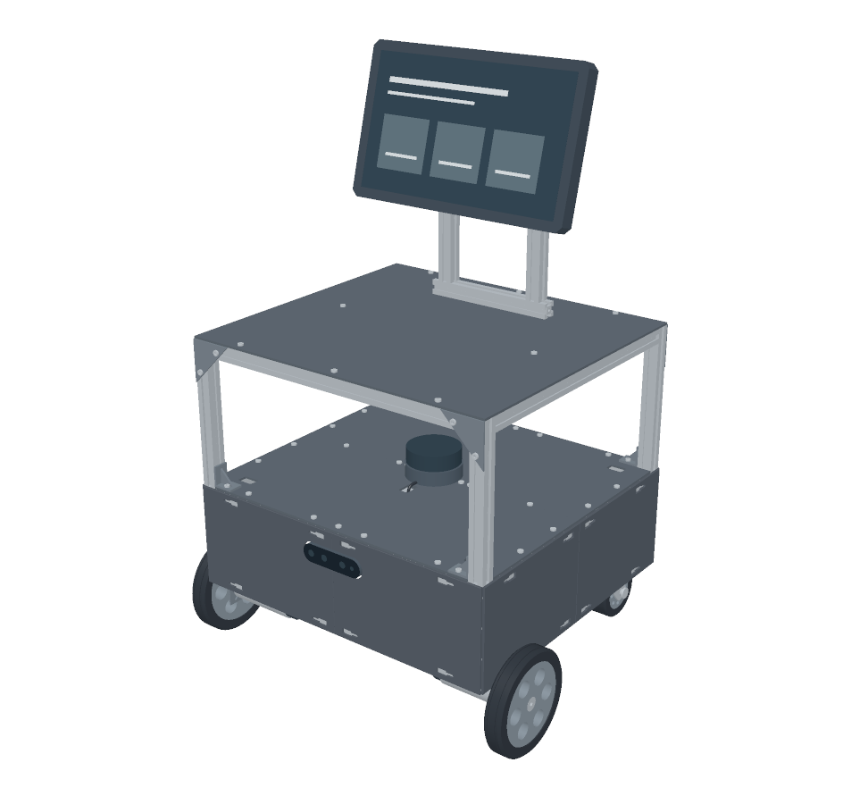

# Complete model structure and layout

[Overall view](../README.en.md) · [한국어](full-model.ko.md) · [Files](parts.en.md)

This document covers the complete model's exterior, coordinates, mounting positions, and extension structures. Product dimensions are in [purchased component specifications](components.en.md); printed interfaces are in [design specifications](design.en.md).

## Base platform

This **exterior reference model** combines the frame and covers with drive wheels, motors, brackets, and two rear casters. Raised corner posts above the deck and internal electronics are omitted. The 2020 extrusion frame measures 440 × 400 × 140 mm including extrusions, with 140 mm vertical corner members.

Units are mm: Y=0 is the front edge of the frame on the D435i side, X=0 is the left frame edge, and Z=0 is the underside of the base frame.

## Exterior model layout dimensions

| Item | Value used in the model |
| --- | --- |
| Drive wheel centers | X = −20, 460 / Y = 60 / Z = −33 |
| Drive wheel center spacing | 480 |
| Caster plate centers | X = 65, 375 / Y = 367.75 / top at Z = 0 |
| Lower rear cross rail centerlines | Y = 345.5, 390 / spacing 44.5 |
| Motor bracket thickness | 2 |
| Motor height adjustment | 2.5 spacer in the model |
| Ground | Z = −101 / drive axle Z = −101 + 68 = −33 |

The bracket drawing gives an axis height of 30–30.5. The model uses 30.5 plus a 2.5 spacer to put all wheels on the same ground plane. Casters are shown in one rearward trailing orientation. Including wheels, the base reference spans approximately **504 × 447.75 × 285**.

| Front perspective | Rear perspective |
| :---: | :---: |
|  |  |
| **Side** | **Top** |
|  |  |
| **Bottom** | **Underside perspective** |
|  |  |

## Three application concepts

All three use the same **third-level platform**. Four 200 mm long 2020 extrusion posts rise from the corner interfaces of the LiDAR deck. A rectangular upper frame and central cross rail support a 440 × 400 × 3 mm aluminum sheet. The posts pass through the existing corner openings to meet the base frame, with lower angle brackets and upper triangular gussets at the connections. Application modules mount above this sheet.

The upper deck surface is at Z=343, with 156 mm between the LiDAR housing top and the sheet underside. Extrusion slots and axial bores use an illustrative 2020 section.

| Example | Concept geometry |
| --- | --- |
| Cargo carrier | A 90 mm high extrusion rim, sheet-panel walls, and two side handholds above the third deck |
| Six-axis robot arm | Two extra cross rails beneath the third deck; an industrial-style arm with a rotary base, shoulder, elbow, wrist, and two-finger gripper |
| Information display | Two extrusion masts and a crossbar, a 320 × 200 mm screen enclosure tilted 15°, and rear mounting plates |

| Cargo carrier CAD | Six-axis arm CAD | Information display CAD |
| :---: | :---: | :---: |
|  |  |  |

The arm is a static exterior model of an industrial-style six-axis arm. Its joint layout represents J1 base rotation, J2 shoulder, J3 elbow, J4 forearm roll, J5 wrist bend, and J6 tool roll.

Wheel spokes, hubs, motor sections, and caster forks are simplified for the exterior view. Fasteners mainly represent their heads, and screen graphics are placeholders.

[Complete model files](parts.en.md#assembly-models) · [Design references](references.md)
