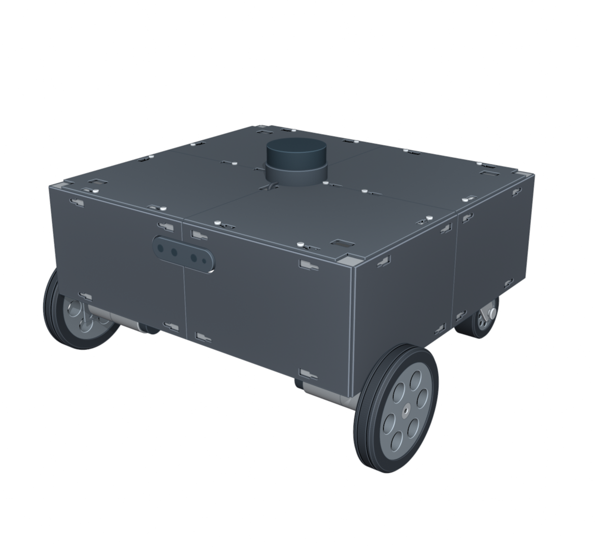
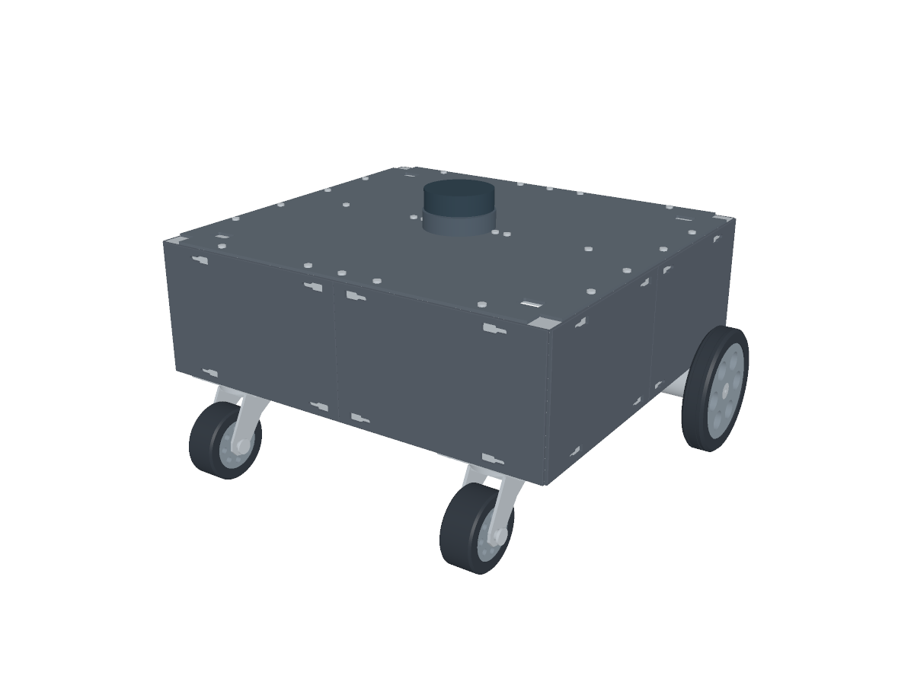
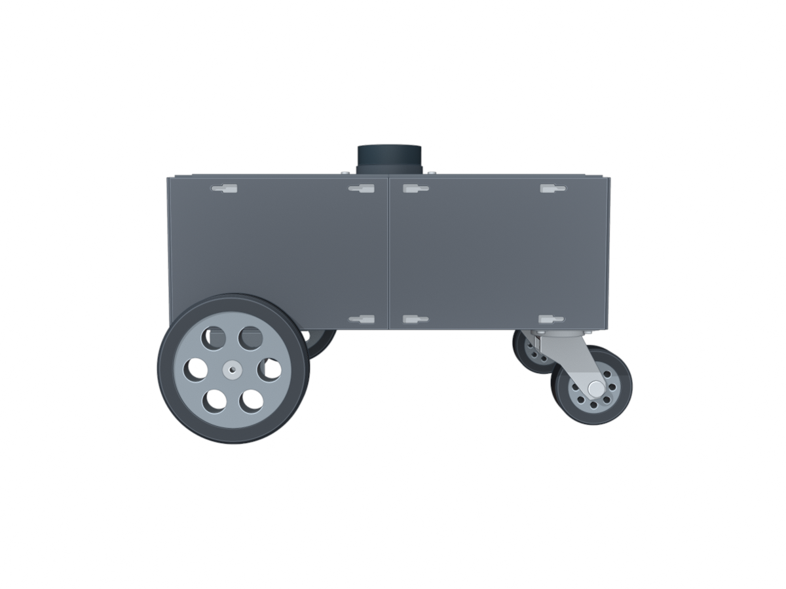
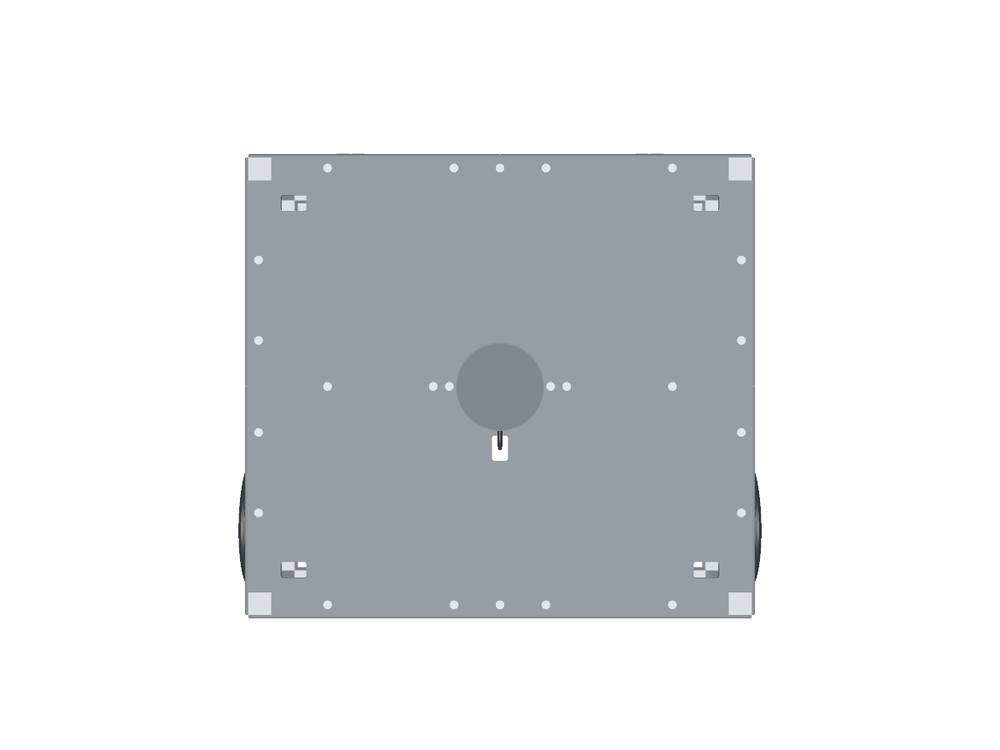
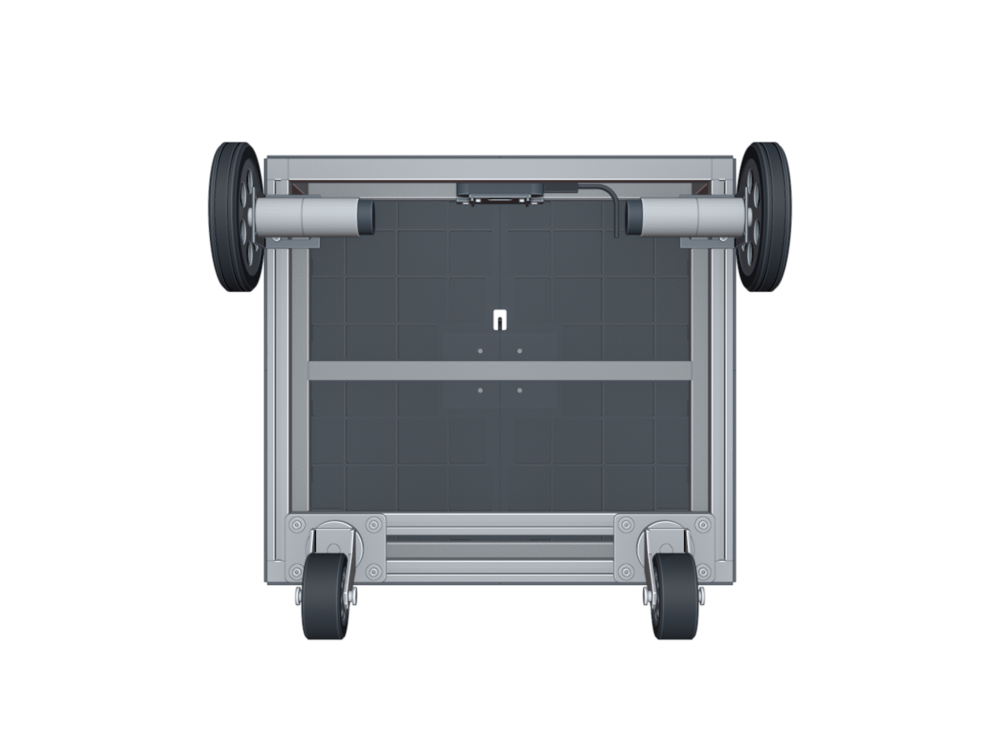
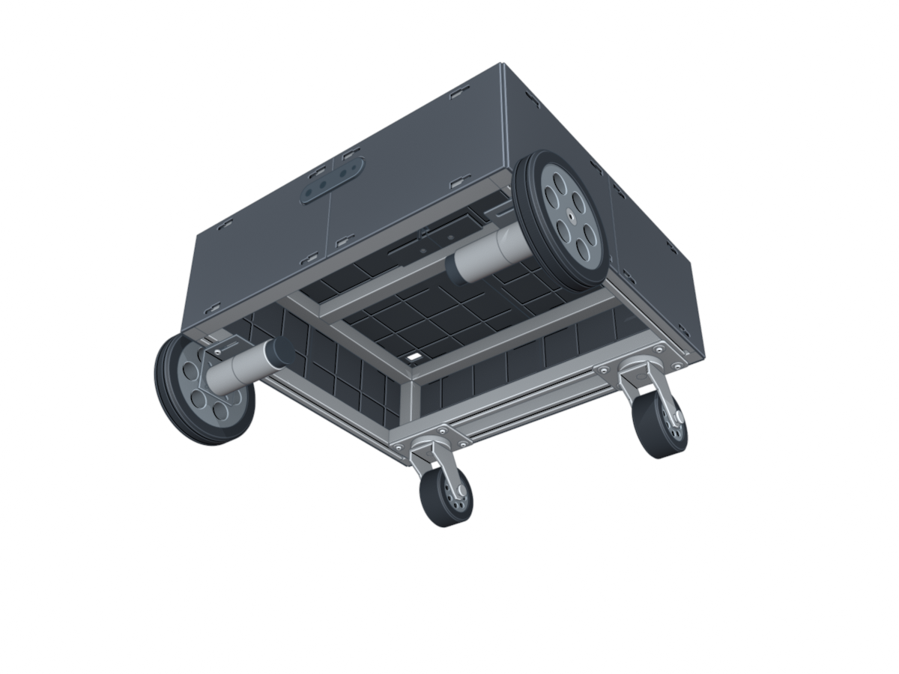
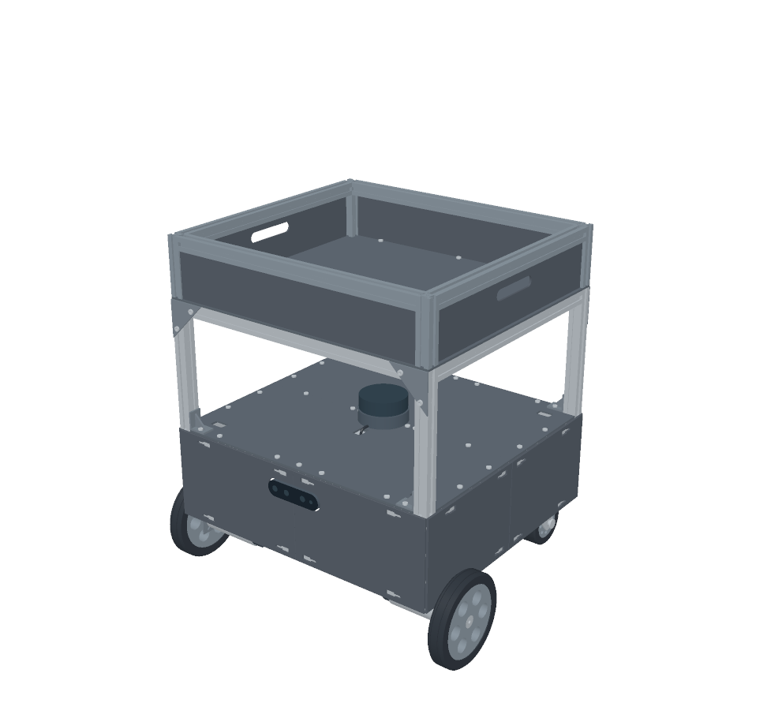
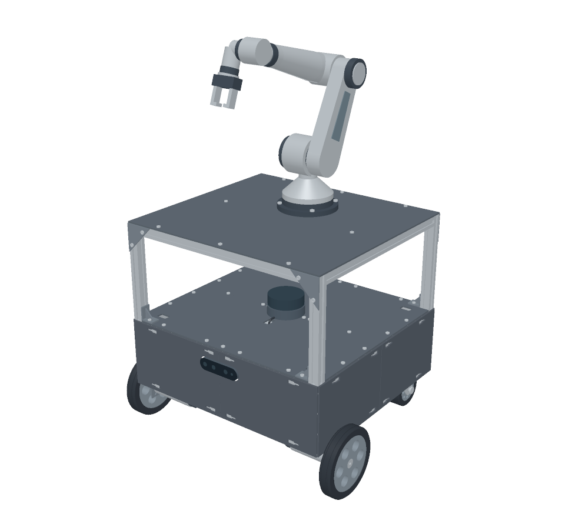
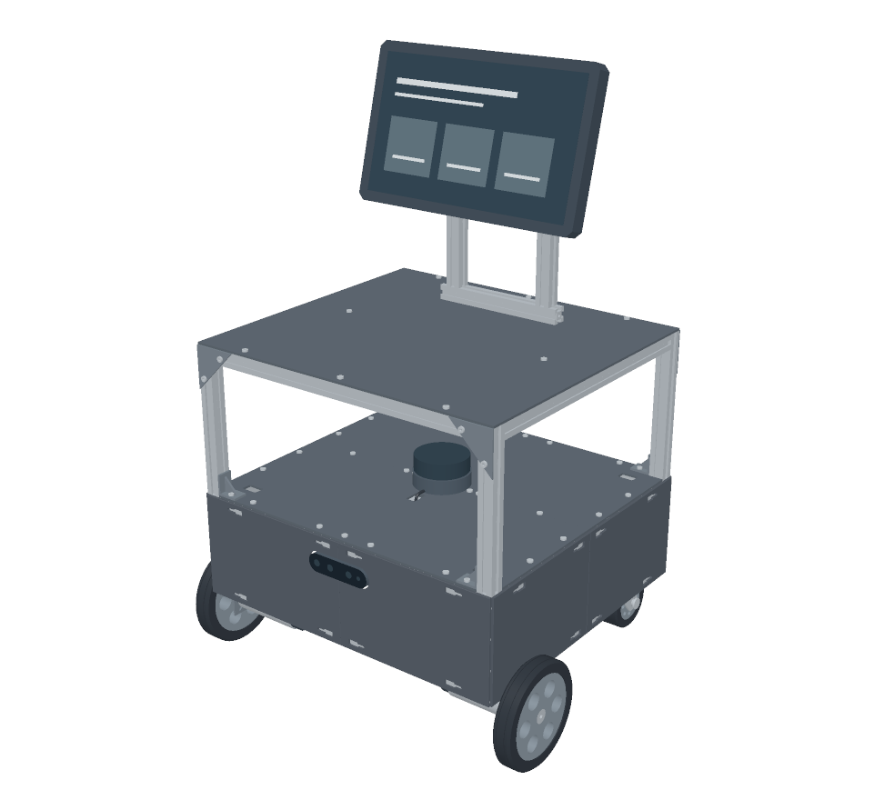

# 전체 모델 구성과 배치

[한국어 README](../README.md) · [English](full-model.en.md) · [파일 목록](parts.ko.md) · [ROS 모델](ros.ko.md)

전체 모델의 외형·좌표·장착 위치와 확장 구조를 설명합니다. 구매 부품의 제품 치수는 [구매 부품 사양](components.ko.md), 출력 부품의 체결부는 [설계 규격](design.ko.md)에 있습니다.

## 기본 베이스

프레임과 커버에 구동 바퀴·모터·브라켓, 후방 캐스터 두 개를 결합한 **외형 참고 모델**입니다. 프레임 외곽은 프로파일을 포함해 440 × 400 × 140 mm이며, 2020 프로파일과 높이 140 mm의 모서리 수직 부재로 구성됩니다. 상판 위로 올라오는 네 모서리 기둥과 내부 전장 배치는 모델에 포함되지 않습니다.

이 문서의 CAD 단위는 mm입니다. 좌표 기준은 D435i 쪽 프레임 전면 Y=0, 프레임 왼쪽 X=0, 기본 프레임 아랫면 Z=0입니다. 같은 외형을 사용하는 ROS 모델의 단위 변환과 링크 좌표계는 [ROS 좌표계](ros.ko.md#frames)에 있습니다.

## 외형 모델의 배치 치수

| 항목 | 모델에 사용한 값 |
| --- | --- |
| 구동 바퀴 중심 | X = −20, 460 / Y = 60 / Z = −33 |
| 좌우 구동 바퀴 중심 거리 | 480 |
| 캐스터 장착판 중심 | X = 65, 375 / Y = 367.75 / 윗면 Z = 0 |
| 후방 하부 가로 부재 중심선 | Y = 345.5, 390 / 간격 44.5 |
| 모터 브라켓 판 두께 | 2 |
| 모터 브라켓 높이 보정 | 모델 기준 간격재 2.5 |
| 지면 | Z = −101 / 구동축 Z = −101 + 68 = −33 |

모델의 중심축 높이는 브라켓 도면의 30~30.5 중 30.5이며, 간격재 2.5를 포함해 네 바퀴가 같은 지면에 닿는 구성입니다. 모델의 캐스터는 뒤쪽으로 따라가는 자세입니다. 이 기본 참고 모델의 바퀴 포함 외곽은 약 **504 × 447.75 × 285**입니다.

| 전면 사시 | 후면 사시 |
| :---: | :---: |
|  |  |
| **측면** | **상면** |
|  |  |
| **하면** | **하부 사시** |
|  |  |

## 세 가지 확장 예시

세 모델은 같은 **공통 3층 플랫폼**을 사용합니다. 라이다 층의 네 모서리 연결 자리에 길이 200 mm인 2020 프로파일 기둥이 있으며, 상부 사각 프레임과 중앙 가로 부재가 440 × 400 × 3 mm 알루미늄 판재를 지지합니다. 기둥은 커버의 모서리 개구부를 지나 기본 프레임에 닿으며, 연결부는 아래쪽 L 브라켓과 위쪽 삼각 연결판으로 구성됩니다. 모듈은 이 상부 판재 위에 설치됩니다.

상부 판재 윗면은 Z=343이며 라이다 본체 윗면에서 판재 아랫면까지 156 mm입니다. 프로파일의 홈·중앙 구멍은 2020 외곽에 맞춘 참고 단면입니다.

| 예시 | 개념 형상 |
| --- | --- |
| 적재함형 | 3층 플랫폼 위 90 mm 높이의 프로파일 테두리, 판재 측벽, 양옆 손잡이 구멍 |
| 6축 로봇암형 | 3층 받침 아래 가로 부재 2개 추가. 회전 베이스·어깨·팔꿈치·손목과 두 손가락 그리퍼를 가진 산업용 6축암 형태 |
| 안내 디스플레이형 | 3층 위 두 개의 프로파일 마스트와 가로 연결대, 기울기 15°의 320 × 200 mm 화면 외곽, 후면 연결판 |

| 적재함형 CAD | 6축 로봇암형 CAD | 안내 디스플레이형 CAD |
| :---: | :---: | :---: |
|  |  |  |

로봇암은 산업용 6축암 형태의 정적 외형 모델입니다. 관절 구성은 J1 베이스 회전, J2 어깨, J3 팔꿈치, J4 전완 회전, J5 손목 굽힘, J6 공구 회전입니다.

구매 부품의 스포크·허브·모터 세부 구간·캐스터 포크는 전체 외형 설명용 단순 형상입니다. 볼트는 머리 위주로 표시되며, 화면의 도형은 표시 예시입니다.

[전체 CAD 파일](parts.ko.md#assembly-models) · [ROS 모델 파일](parts.ko.md#ros-models) · [자료 출처](references.md)
